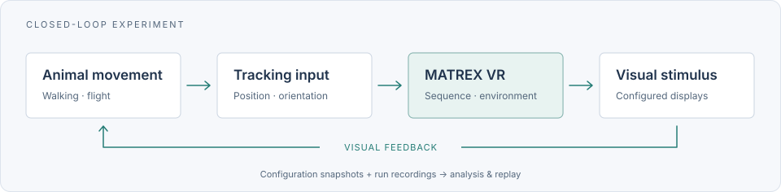
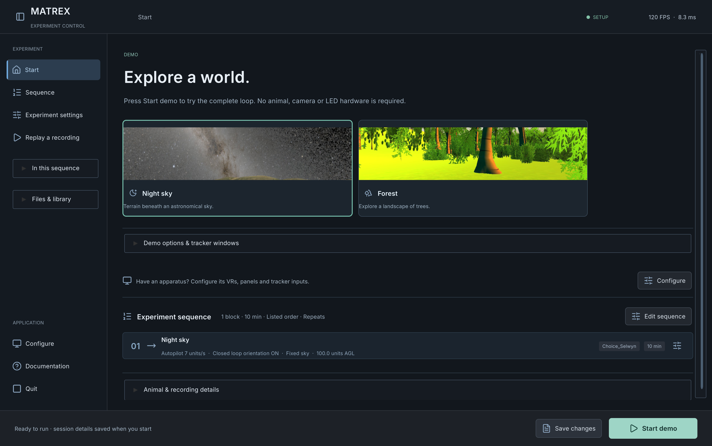
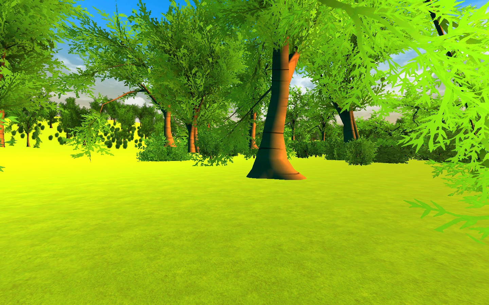
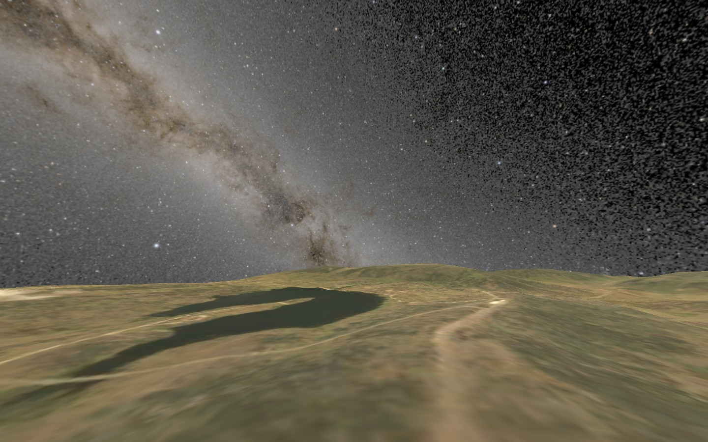
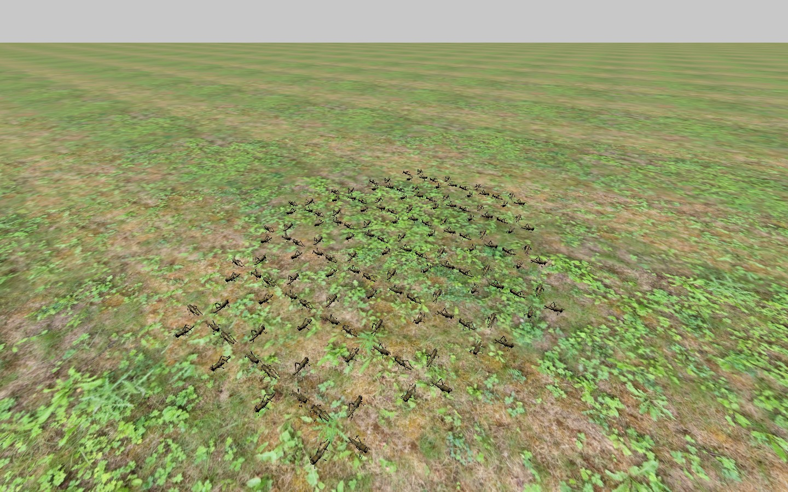
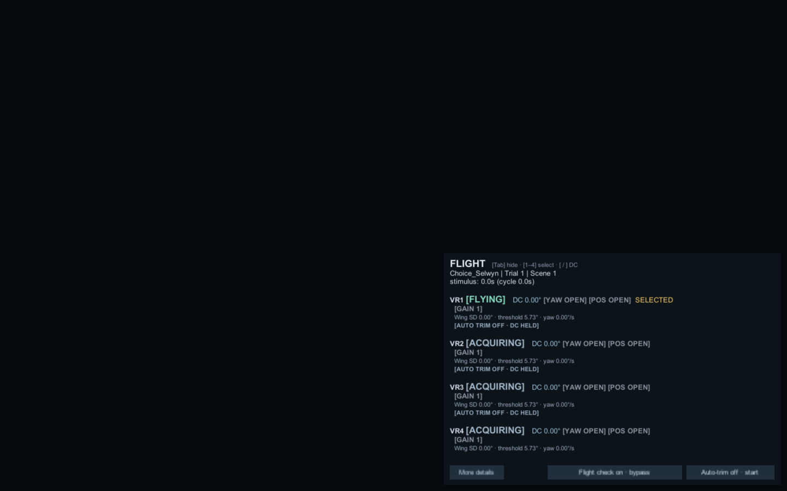
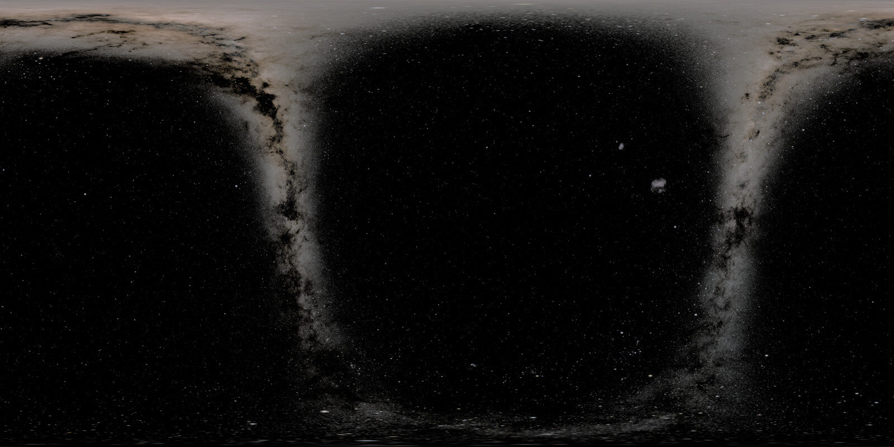
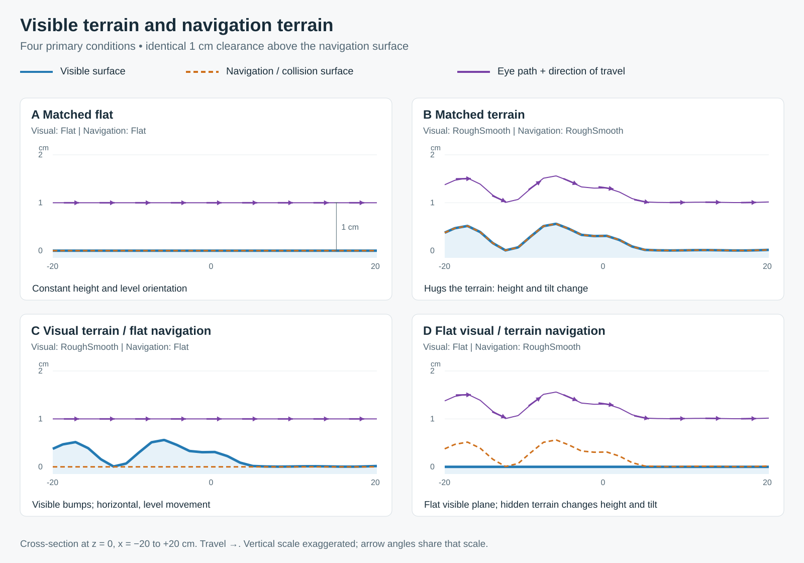

<p align="center">
  
</p>
<h1 align="center">MATREX VR</h1>
<p align="center"><strong>Closed-loop virtual environments for animal behaviour research</strong></p>
<p align="center">Configure visual stimuli. Connect tracking. Record and replay experiments.</p>

<p align="center">
  <a href="https://github.com/pvnkmrksk/matrexVR/releases"></a>
  <a href="ProjectSettings/ProjectVersion.txt"></a>
  <a href="https://github.com/pvnkmrksk/matrexVR/releases"></a>
  <a href="https://pvnkmrksk.github.io/matrexVR/manual/"></a>
  <a href="CITATION.cff"></a>
</p>
<p align="center">
  <a href="https://pvnkmrksk.github.io/matrexVR/"><strong>Website</strong></a> ·
  <a href="#quick-start"><strong>Quick start</strong></a> ·
  <a href="https://pvnkmrksk.github.io/matrexVR/manual/"><strong>Manual</strong></a> ·
  <a href="https://pvnkmrksk.github.io/matrexVR/manual/gallery.html"><strong>Scene gallery</strong></a> ·
  <a href="https://github.com/pvnkmrksk/matrexVR/releases"><strong>Downloads</strong></a>
</p>

---

MATREX VR is a Unity application for flight, walking and collective-behaviour experiments. It connects tracked animal movement to configurable visual environments, with multi-rig display routing, experimental sequences, configuration snapshots and saved-run replay.

<p align="center"></p>

## Capabilities

| | Research workflow |
| :--- | :--- |
| **◎ Closed-loop stimuli** | Flight and walking input contracts, independent rig routing and configurable display geometry. |
| **▦ Experimental environments** | Choice tasks, terrain cues, Optomotor, astronomical night skies, generated/recorded swarms and Kannadi mirror matrices. |
| **⚙ Visual configuration** | Arrange sequence blocks and edit parameters in the studio or JSON. Unknown fields and untouched values are preserved. |
| **↺ Recording & replay** | An installation-local run library, configuration snapshots and synchronized saved poses/video, with adjustable overview and animal views. |

## Quick start

### Use a desktop release

1. **[Download an OS archive](https://github.com/pvnkmrksk/matrexVR/releases)** and extract the entire ZIP into a writable folder. Keep the application and its supporting files together. Unity Editor is not required to run a release.
2. **Read the included `START-HERE.txt`**, then open the application. Startup behaviour differs between versions; use the instructions packaged with your release.
3. **Try the demo or configure an apparatus.** Current desktop builds offer **Start demo** without animal hardware. Use **Configure** for tracker input, displays and LED geometry before acquisition.
4. **Set session labels and sequence blocks.** Use **Initialize tracking** to inspect input before starting, then save the setup and start the experiment. Keep the complete run directory for analysis and replay.

**Desktop 0.4.0 release target:** [publication status and platform packages](https://github.com/pvnkmrksk/matrexVR/releases/tag/v0.4.0). Four shared terrain-choice layouts, independent visual/navigation treatments and refined recording/video replay extend the desktop workflow. macOS packages are ad hoc signed and not notarized. See [0.4 features and platform limits](docs/releases.md#04--terrain-recording-and-replay).

[Setup & controls](docs/getting-started.md) · [Connect a tracker](docs/tracker-integration.md) · [Configuration reference](docs/configuration-reference.md) · [Replay a run](docs/replay.md)

### Try the current desktop preview

Install and activate **Unity 6000.3.16f1** with desktop build support. Apple Silicon maintainer builds also require a stable **Rust** toolchain and the reviewed dashboard archive described in the [native companion build guide](tools/native_patches/README.md).

```sh
git clone https://github.com/pvnkmrksk/matrexVR.git
cd matrexVR
python3 tools/build_local_desktop.py
```

The local Mac builder creates **`.local/MATREX VR.app`** from your checkout with checksum-verified native companions. It publishes no release; the finished app needs neither Unity nor Rust. For source development, add the project to Unity Hub, let pinned packages restore, and open `Assets/Scenes/ControlScene.unity`.

<details>
<summary><strong>Desktop interface preview</strong></summary>



Actual Mac player, 3024 × 1898, 2× UI scale, fresh demo profile. [Capture provenance](docs/images/desktop-ui/current-player-provenance.json) · [Desktop workflow](docs/desktop-experience.md).

</details>

## Experimental environments

| Choice & forest | Terrain & night sky | Kannadi · ಕನ್ನಡಿ |
| :---: | :---: | :---: |
| [](https://pvnkmrksk.github.io/matrexVR/manual/gallery.html#forest-choice) | [](https://pvnkmrksk.github.io/matrexVR/manual/gallery.html#milky-way-terrain) | [](https://pvnkmrksk.github.io/matrexVR/manual/gallery.html#kannadi) |

Actual Unity renders with synthetic inputs. The forest capture is an optional **Choice_Forrest + Landscape** source setup, separate from the desktop Forest starter. [All nine gallery examples, configurations and provenance →](https://pvnkmrksk.github.io/matrexVR/manual/gallery.html)

## Documentation

| Get running | Configure & extend | Understand the data |
| :--- | :--- | :--- |
| [Installation & controls](docs/getting-started.md) | [Configuration studio](docs/configuration-ui.md) | [Recording formats & units](docs/data-formats.md) |
| [Tracker integration](docs/tracker-integration.md) | [Templates & examples](Assets/StreamingAssets/Examples/README.md) | [Snapshots & provenance](docs/run-config-snapshots.md) |
| [Bundled companion apps](docs/bundled-companions.md) | [Add an experiment](docs/experiment-workflow.md) | [Saved-run replay](docs/replay.md) |
| [Release history](docs/releases.md) | [Parameter reference](docs/configuration-reference.md) | [Full searchable manual](https://pvnkmrksk.github.io/matrexVR/manual/) |

## Tracking & analysis ecosystem

| Component | Role |
| :--- | :--- |
| [**Rekkefly**](https://github.com/pvnkmrksk/rekkefly) / [**HejjéTrac**](https://github.com/pvnkmrksk/hejjetrak) | Native flight/wing tracking or spherical-treadmill walking input. |
| **MATREX VR** | Visual environments, experimental sequencing and recording. |
| [**Daari Deepa**](https://pvnkmrksk.github.io/trajectory-dashboard/) | Optional external live plots and saved-trajectory analysis. |

Trackers run as independent processes. External plots can run on the acquisition computer or another computer; [live monitoring](https://pvnkmrksk.github.io/matrexVR/manual/live-monitoring.html) describes the telemetry connection.

## Validation & reproducibility

Software checks use simulated or prerecorded inputs; physical tracker calibration, display mapping and LED timing require checks on the actual apparatus. Preserve the complete recording folder and cite the exact software revision used for acquisition.

- [Desktop UI validation](docs/desktop-ui-validation-results.json) and [native player checks](docs/desktop-player-validation-results.json).
- [Record → replay verification](docs/replay-roundtrip-validation.md), including paired renders and reconstruction limits.
- [Manual Mac workflow validation](docs/manual-mac-workflow-validation.md) and [scene lifecycle investigation](docs/diagnostics.md).
- [Latest Mac terrain/video/replay review](docs/replay-recording-mac-review-20261027.md). Evenly paced 60 FPS and acknowledged per-run recorder control remain open; latest standalone pointer acceptance is incomplete. Windows/Linux builds are cross-built without native walkthroughs. [Full 0.4 verification and companion requirements](docs/releases.md#04-verification-and-known-limits).

<details>
<summary><strong>Archived versions and their startup behaviour</strong></summary>

## Choose a version

| Version | Purpose | Source |
| --- | --- | --- |
| **0.1** | Archive of `main`, before the configuration studio and telemetry integration. | [`779926a8`](https://github.com/pvnkmrksk/matrexVR/tree/779926a80b02190d6dd0410f260e52bba105a04e) |
| **0.2** | Preserved Config UI Test baseline: studio, live dashboard, telemetry, modern Kannadi/Bogong and terrain cue lab. | [`c13d33dd`](https://github.com/pvnkmrksk/matrexVR/tree/c13d33dd) |
| **0.3** | Holistic improvements: reversible configuration, writable profiles, configurable animals and saved-run replay/lifecycle cleanup. | [`v0.3.0`](https://github.com/pvnkmrksk/matrexVR/tree/v0.3.0) · [verification](docs/releases.md#software-verification) |

Download the ZIP for your operating system, extract the **whole archive**, and launch the application. Unity Editor is needed only to modify or build the source. Each release includes `START-HERE.txt` with its exact startup behavior, configuration/data paths and shortcuts. Published download availability is listed on [GitHub Releases](https://github.com/pvnkmrksk/matrexVR/releases); the website resolves actual uploaded OS archives.

### Archived 0.3 workflow

1. Open **ControlScene** in Unity **6000.3.16f1**, or launch a standalone player. Use `-configure` to open setup when a sequence has auto-start enabled. Escape returns a running experiment to Control.
2. In **System config**, configure each rig's tracker endpoint/mode, physical display, panel geometry, camera order and sphere diameter. The complete [system template](Assets/StreamingAssets/Templates/system_config.template.json) is a starting point for your apparatus. Keep `closedLoopMode: "Kinefly"` for flight; [walking examples](Assets/StreamingAssets/Examples/System) select their own input contract.
3. In **Session**, enter experimenter, animal IDs, species and comments. The system configuration's `speciesName` records species per rig. Hardware IDs such as `VR1` route inputs/displays; `AnimalID` labels the real animal. Simulated and replayed individuals are **agents**.
4. Arrange blocks in **Sequence config**. Choose a recipe from **Experiment configs**, edit its motion/stimulus/sky settings, or inspect **Edit JSON**. [Templates](Assets/StreamingAssets/Templates/README.md) and [examples](Assets/StreamingAssets/Examples/README.md) cover the supported paradigms.
5. **Save setup**, then **Start experiment**. Keep the whole saved run, including configuration snapshots, data and generated skies, for analysis and replay.

The configuration studio and JSON share one lossless document model. No-op saves preserve the original file bytes. Actual edits preserve unknown fields, property order and untouched numeric text; absent settings, explicit null, false and zero remain distinct. Showing an **Inherited** default never inserts it. Undo/Redo and external-file conflict checks protect the editing workflow. See [GUI and JSON parity](docs/configuration-ui.md).

A fresh 0.3 profile opens setup by default. Its supplied demonstration is **TerrainCueLab**: four visual/navigation mesh combinations followed by height-only, tilt-only and fixed-pose controls, 30 seconds each, with `reloadScene: false`. The previous Selwyn cycle is preserved in `Examples/Sequences/selwyn-before-rugosity.json`. Configuration JSON is authoritative; old branch guides may describe their historical default sequence.


</details>

<details>
<summary><strong>Controls, paradigms, data compatibility and source reference</strong></summary>

## Controls and live monitoring

Focus the Game/player view. Experiment hotkeys are suppressed while typing into metadata fields.

| Control | Action |
| --- | --- |
| **R** | Reset rigs to the current experiment's initial pose. |
| **P / O** | Toggle tracked position / tracked orientation. |
| **Arrow keys; A / D** | Manual translation; positive / negative yaw, when manual controls are enabled. |
| **Ctrl+Space** | Toggle forward autopilot at the active config's `autopilotSpeed`. |
| **Shift+Up/Down; Shift+W/S** | Adjust manual translation speed; adjust turn speed. |
| **Tab** | Hide/restore operator graphics together during a run; navigate fields during setup. |
| **Escape, on release** | Stop and return to Control; from Control, exit the standalone player. |
| **Right / middle drag; wheel** | Orbit / pan; zoom inside the operator overview. |
| **Space; Left/Right; N/M** | Replay play/pause; seek (Shift for 10 seconds); previous/next step. |

Kinefly controls retain **+/−** for yaw gain, **Ctrl+Y** for yaw-rate mode, **1–9** for matching rig IDs, **0** or the HUD’s **Next animal** button to cycle all configured IDs (including `VR10`), and held **[/]** for DC offset. Optional vertical/pitch/roll and gamepad bindings are covered in the [full controls guide](docs/unity6-controls.md). Autopilot retains steering/reverse input; Optomotor disables it.

The in-app dashboard reports tracking freshness, flight and trim state, gains/DC offsets, heading measurements, phase/sequence state, frame timing and errors. Error capture and telemetry continue while graphics are hidden. Outbound **ZMQ PUB telemetry** is separate from tracking inputs: default `127.0.0.1:9880`, 20 Hz, topic `matrex.telemetry.v2`, schema version 2. A static website cannot consume raw ZMQ directly. See [telemetry](docs/heading-reference-telemetry.md), [auto trim](docs/kinefly-auto-trim.md) and [data formats](docs/data-formats.md).



*Native 0.2 HUD capture with synthetic validation inputs; current selection also supports 1–9 and 0/Next animal.*

## Automatic night sky

Choose observer latitude/longitude, date/local time and UTC offset, or set `localTime: "now"`. The bundled NASA star panorama and Astronomy Engine generate the stars/Milky Way orientation offline; no Stellarium process or runtime internet is required. Configurable updates save each displayed PNG, hash, represented UTC and provenance alongside the run. Explicit `skyboxPath` images remain supported.



*Actual full-sphere stimulus panorama, downsampled without changing brightness: Selwyn, −35.894409°, 148.453948°, sampled 7 October 2026 at 07:14 UTC. [Manifest](docs/site/assets/selwyn-night-sky.provenance.json) · [credits](docs/site/assets/README.md). NASA/Goddard SVS; Ernie Wright (USRA); ESA/Gaia/DPAC. Stars and Milky Way only; atmosphere, Sun, Moon and planets are not modeled.*

See [night-sky configuration and audit files](docs/night-sky.md), [Selwyn cycle](docs/selwyn-milky-way-swarm-cycle.md), [generated swarms](docs/generated-bogong-swarm.md) and [recorded swarm playback](docs/swarm-playback.md).

## Terrain and experimental scenes

Four **TerrainChoice** layouts share one environment prefab and two equidistant placeholder trees. The [four treatment sequences](docs/rugosity.md#load-one-treatment-and-run-all-four-spatial-patterns) independently select visible and navigation surfaces across those layouts, using a shared centimeter recipe with 1 cm clearance and texture scale 4. Both-flat trials intentionally have identical geometry. **TerrainCueLab**, Rugosity_RS and historical scenes retain their identities. [The rugosity guide](docs/rugosity.md) explains the recipes, geometry and precedence.



The compact build contains fourteen scenes: **ControlScene, Choice, Choice_desync, Choice_Selwyn, Swarm, Kannadi, Optomotor, TerrainCueLab, Rugosity_RS, ReplayScene, TerrainChoice_RoughLeft_SmoothRight, TerrainChoice_SmoothLeft_RoughRight, TerrainChoice_BothSmooth and TerrainChoice_BothRough**. The current desktop Forest starter uses Choice_Selwyn terrain with grounded tree objects. Separate legacy forest/two-tree examples are marked `sourceBuildOnly`; enable their scenes and rebuild to run those examples. Add custom scenes, assets and controllers in Unity, enable them in the build scene list, and rebuild. See [experiment workflow](docs/experiment-workflow.md); this project does not provide a general level editor.

## Compatibility and saved runs

Use `agentCount`, `agentSpeed` and `agentSpeedStdDev` for simulated populations; `locustSpeed` and `locoSpeed` remain accepted. Precedence is `agentSpeed` → `locustSpeed` → `locoSpeed`. The UI preserves existing key spellings; using a canonical key is an explicit configuration choice. New metadata uses `Animals`, `AnimalID`, `SpeciesName` and `UsedAnimalIDs`, retaining transitional `Flies`/`FlyID`/`UsedFlyIDs` aliases for existing analysis. [Animal/agent compatibility](docs/animal-agent-compatibility.md) and [version differences](docs/releases.md) give the scope.

In 0.4 standalone players, configuration remains under `Application.persistentDataPath/Config`; seeding never replaces existing files. Recordings default to **`MATREX VR RunData` beside the app or executable**. Protected installations use `Application.persistentDataPath/Installations/<installation-id>/RunData`; the library shows its exact root. `--config-dir <folder>` and `--data-dir <folder>` override these locations. Editor defaults remain `Assets/StreamingAssets` and `Assets/RunData`. Archived 0.3 players used shared `Application.persistentDataPath/RunData`, accessible through Browse; 0.1/0.2 retain their older application-relative paths. See [getting started](docs/getting-started.md) and [run snapshots](docs/run-config-snapshots.md).

Repeated transitions now have explicit owners for trial materials, generated Optomotor resources, writer handles and tracking workers. The in-scene `reloadScene: false` path remains available. See [scene lifecycle fixes and their limits](docs/scene-lifecycle.md); no original crash dump establishes a single cause.

Replay reads saved animal poses and recorded stimulus evidence. Preserve the complete run directory, its `Configs` archive and `Skyboxes`; choose **Replay recordings** in setup, use **Browse…** for an external location, or pass `--replay-session <folder>`, then follow the [replay guide](docs/replay.md). Older incomplete recordings cannot establish stimulus details that were never saved.

## Reference and source development

| Guide | Contents |
| --- | --- |
| [Getting started](docs/getting-started.md) | Downloads, launch/configuration, data locations and controls. |
| [Configuration reference](docs/configuration-reference.md) | Parameters, units, defaults, precedence and historical no-op fields. |
| [Configuration studio](docs/configuration-ui.md) / [GUI and HUD](docs/configuration-ux.md) | Forms, raw JSON, inherited values, Undo/Redo and dashboard. |
| [Data formats](docs/data-formats.md) / [run snapshots](docs/run-config-snapshots.md) | CSVs, clocks, units, original inputs and immutable versions. |
| [Replay](docs/replay.md) | Saved-run loading, timeline, overview and reconstruction limits. |
| [Kannadi](docs/kannadi-modernization.md) | Mirror populations, camera routing and software validation history. |
| [Experiment phases](docs/experiment-phases.md) | Pre/stimulus/post conditions and heading references. |
| [Release history](docs/releases.md) | Archival source pins, platform builds and compatibility changes. |

Packages are pinned in `Packages/manifest.json` and `packages-lock.json`. After pulling an input-backend change into an open Editor, restart it. For optional Linux/FicTrac acquisition setup, see the [source installation guide](docs/getting-started.md#source-and-tracker-setup).

Archived 0.3 verification includes [1,293 Unity lifecycle/replay checks](docs/lifecycle-replay-validation-results.json), with **150 actual Choice↔Swarm scene loads** at accelerated 0.1-second durations and 150 native resource teardown cycles; [43 JSON compatibility contracts](docs/config-compatibility-validation-results.json); [71 rig isolation checks](docs/release-readiness-results.json); and [2,946 fresh 0.3 GUI checks/captures](docs/configuration-dashboard-v0.3-validation-results.json). [Release verification](docs/releases.md#software-verification) gives the scope, including 630 offline replay checks. This does not establish a cure for the historical crash during 30-second hardware acquisition.

Run `python3 tools/validate_kannadi_assets.py` and `python3 tools/validate_config_templates.py` for static checks. Unity regression runners under `Assets/Editor` require a disposable copy containing the `KANNADI_VALIDATION_COPY` sentinel. Historical reports document synthetic/rendered software checks; physical LED timing, tracker calibration and display mapping require a bench check on the actual apparatus.

The prior README identifies MIT licensing, but this checkout has no root LICENSE file. Third-party assets retain their own license terms. Engine: [Unity](https://unity.com/). Tracking transport: [NetMQ](https://github.com/zeromq/netmq). Astronomical orientation: bundled Astronomy Engine with its retained MIT notice.

</details>

## Citation

Use [CITATION.cff](CITATION.cff) and record the exact release/source revision used for acquisition. [Citation and stimulus credits](https://pvnkmrksk.github.io/matrexVR/manual/citation.html) distinguish the software from its bundled dependencies and sky sources.
