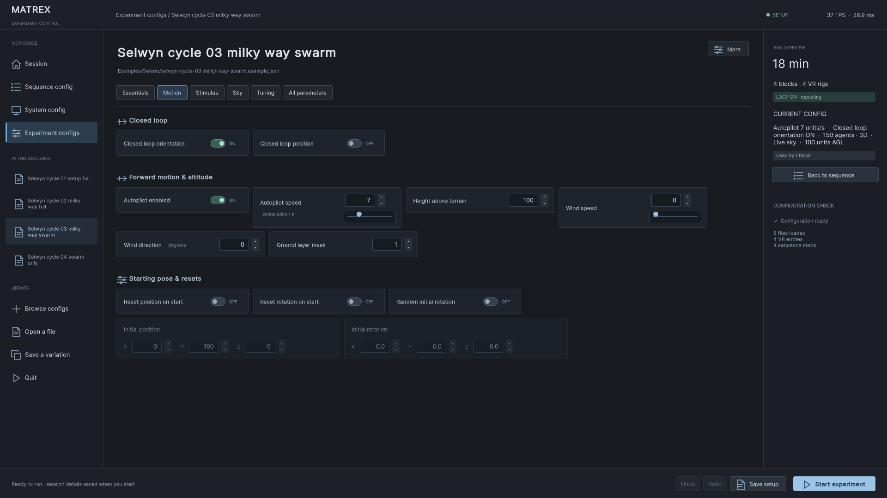
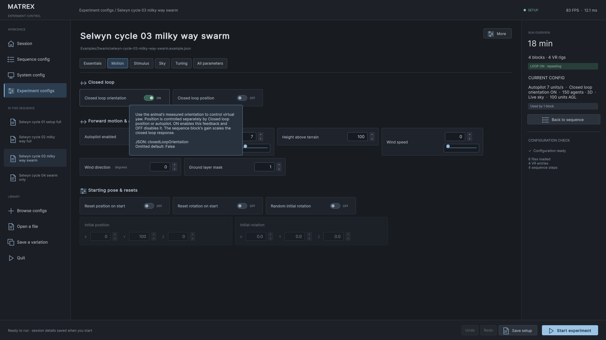
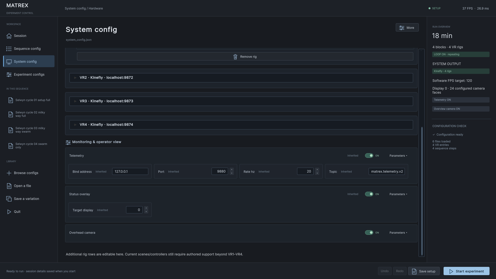

# Configuration GUI and operator HUD

The Config UI Test work is preserved in the 0.2 baseline and carried into current source. Older Bogong-only builds retain their historical interface. Open ControlScene and press Play, or use **Tools → Experiment setup → Open setup screen (Play)**. No GUI changes are pushed to the Bogong branch by this work.

The dashboard is designed first for **1920 × 1080**. Session, Sequence config, System config and Experiment configs always occupy the same left navigation rail, with a selected-page highlight. The header carries page context, setup state and live FPS/frame time; the independent FPS canvas is suspended while setup is open and restored for the run. The footer owns Save and Start. Experiment controls stay in the workspace, and the secondary overview gives run context. Smaller windows retain the navigation and use vertical scrolling where necessary; horizontal scrollbars are hidden and controls are checked for overflow.

Motion uses the community terms **Closed loop orientation** and **Closed loop position**. The first controls measured yaw, and the second controls measured translation; autopilot and starting-pose resets are separate groups. Compact switches, short numeric entries and expandable feature headers avoid stretching a simple value across the screen.

Hover over a field, switch or label for its behavior, units, JSON path and omitted default. Help is rendered by the setup panel in both Play mode and standalone builds: Unity's built-in [`tooltip` property](https://docs.unity3d.com/6000.3/Documentation/ScriptReference/UIElements.VisualElement-tooltip.html) only displays in Editor UI. Descriptions are shared through `Resources/ConfigurationUI/field-help.json`, with schema-specific help for overloaded fields such as optomotor angular speed and playback time scale.

Omitted fields with defined defaults are shown automatically and marked **Inherited**. Monitoring defaults are explicit previews: telemetry ON, localhost port 9880 at 20 Hz; status overlay ON on display 0. The schema is generated from runtime configuration classes, including initialized objects and vectors. Opening an inherited object, expanding it or navigating never writes defaults into the user's JSON. Editing an inherited child writes only the selected path; Undo restores the original omission. Explicit `null` remains distinct from an omitted default. **All parameters → Show unset optional fields** exposes additional null/unspecified entries.

The editor uses compact numeric spin controls with exact text entry. Click the up/down arrows, press Up/Down while editing, or use the wheel over a focused number. Shift multiplies the step by ten; Alt divides fractional steps by ten. Counts and ports step as integers. Sliders appear for continuous adjustments such as speed, gain, contrast, exposure and directional concentration. Gain sliders cover **0–50**; exact entry retains negative and larger values. A value outside the slider's range remains visible and unchanged until explicitly edited. Spin arithmetic preserves decimal digits beyond double precision.

Colors use Unity's native `UnityEditor.UIElements.ColorField` in Editor Play mode, including its color picker and eyedropper. Standalone builds use a compact hex/RGB/alpha dialog, because the editor picker is not available in a player. Missing alpha keys are not inserted; extension keys inside a color object are retained. [Unity ColorField documentation](https://docs.unity3d.com/6000.0/Manual/UIE-uxml-element-ColorField.html).

Forms adapt to the actual window width. Smaller windows hide the secondary overview so controls retain usable space; short numeric values occupy compact input boxes rather than stretching across a column. Vector components stay together. The metadata form, sequence builder, main settings, optional fields, raw JSON and unknown parameters remain accessible. **Add parameter…** accepts a new key and an arbitrary JSON value. Viewing controls does not change a file. Edits, JSON mode, Save, Undo and Redo use the same lossless document model, including unusual numeric precision and future extension fields.

## Scene duration takes precedence

Heading observation no longer extends a scene. Flat experiments use the sequence row's duration; phased experiments use the configured phase `durationSeconds`. The effective window is:

```text
min(requested windowSeconds, scene/phase duration − startOffsetSeconds)
```

The GUI shows a small amber warning when a window is shortened. The original `windowSeconds` remains in the JSON and archived config; the heading result logs both `requestedWindowSeconds` and effective `windowSeconds`. Observation still measures the animal's actual virtual yaw and completes before the next condition uses the saved mean. An offset at or after the scene end is a configuration error, because no observation interval exists.

The legacy `measureDuringPresentation` key is retained for file compatibility. It no longer adds an assessment period to the scene clock. Its false value can still cause legacy spawners to reapply the completed reference. Use separate pre-stimulus and stimulus phases when a dedicated assessment condition is required.

## Flight HUD and hiding

Each active rig leads with its flight state: Flying, Not flying, or Acquiring while the flight detector lacks a qualified window. DC, gains, tracking modes and basic trim information use smaller, quieter information tiers. **More details** expands the full sample/window statistics, input endpoints and telemetry; **Less details** returns to the compact view. Cool gray is neutral, green indicates flying/active, amber indicates operator bypasses or warnings, and errors remain distinct.

Tab works during experiments, including when an old metadata input retained focus. Action callbacks and a frame-state fallback are debounced so one press cannot toggle twice. In setup, Tab retains form navigation. During a run, it hides/restores status, FPS, overview, desktop controls and replay controls together. The status/FPS/overview allocator keeps their panels outside calibrated LED rectangles, omitting any panel that cannot fit. Panel contents are clipped to their reserved bounds. A one-frame washout clears retained operator pixels before stimulus cameras render, so hiding leaves LED output intact. Error capture and telemetry continue while graphics are hidden.

## Verification

The [current overlay report](operator-overlay-validation-results.json) adds **172 native framebuffer assertions** across seven 1920×1080 LED layouts, including real Tab input, first-frame washout and restore, plus **6,428 actual-source geometry/visibility assertions** across 24 LED configurations and 1,500 random obstacle layouts. Native screenshots include the unchanged ScreenSpaceOverlay canvases; camera-only targets were not used as proof of UI compositing.

The validation report records 5,987 studio checks, 40 focused UX checks, 4,422 phase/heading checks, standalone macOS script compilation, 66 current configs and 10 Python tests.

The studio regression tests cover lossless no-op saves, edits to config leaves, arbitrary extensions, exact numbers, undo/redo, native input and virtualized sequences. `ConfigurationUXValidation` adds rendered layouts at 1024×720, 1440×900 and 1920×1080; native color callbacks; precise mouse/keyboard spin controls; future parameter addition; an actual 30-second request capped to a 0.7-second flight condition; real Tab input; black pixel output and one-render camera shutdown. Rendering tests use a disposable project and synthetic inputs, not a live animal session.

See `configuration-ux-validation-results.json` and the images under `docs/images/ux/` for the recorded checks and native captures. Player script compilation checks the standalone path without the Editor-only color picker.

The dashboard revision adds 2,773 native checks for fixed navigation, Full HD geometry, subject clipping, FPS ownership, runtime hover events, descriptions for every schema property, and default edits/Undo. The existing studio suite passes 5,987 checks; the interaction/HUD suite passes 40 checks at 1024, 1440 and 1920 pixels. Standalone macOS player scripts compile. The config validator passes all 66 templates/examples, and all 10 Python tests pass. See [dashboard validation summary](configuration-dashboard-validation-summary.json) and [detailed results](configuration-dashboard-validation-results.json). Captures use example configs and synthetic metadata in a disposable Unity project.







Native captures:


