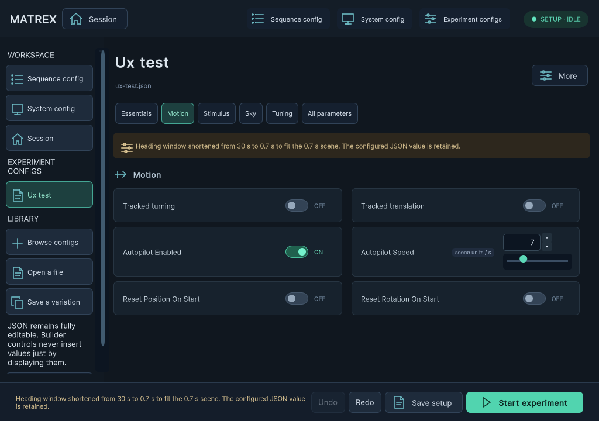
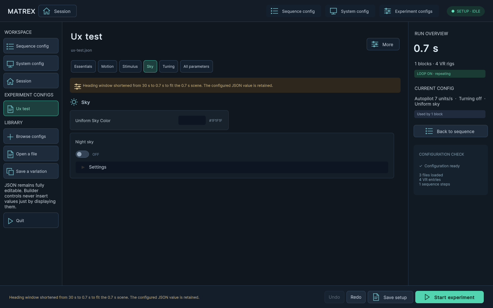

# Configuration GUI and operator HUD

The experimental GUI remains on `codex/config-ui-test`. The Bogong night-sky branch keeps the older interface. Open ControlScene and press Play, or use **Tools → Experiment setup → Open setup screen (Play)**. No GUI changes are pushed to the Bogong branch by this work.

The editor uses compact numeric spin controls with exact text entry. Click the up/down arrows, press Up/Down while editing, or use the wheel over a focused number. Shift multiplies the step by ten; Alt divides fractional steps by ten. Counts and ports step as integers. Sliders appear for continuous adjustments such as speed, gain, contrast, exposure and directional concentration. A value outside the slider's range remains visible and unchanged until explicitly edited. Spin arithmetic preserves decimal digits beyond double precision.

Colors use Unity's native `UnityEditor.UIElements.ColorField` in Editor Play mode, including its color picker and eyedropper. Standalone builds use a compact hex/RGB/alpha dialog, because the editor picker is not available in a player. Missing alpha keys are not inserted; extension keys inside a color object are retained. [Unity ColorField documentation](https://docs.unity3d.com/6000.0/Manual/UIE-uxml-element-ColorField.html).

Forms adapt to the actual window width. Smaller windows hide the secondary overview so controls retain usable space; short numeric values occupy compact input boxes rather than stretching across a column. Vector components stay together. The metadata form, sequence builder, main settings, optional fields, raw JSON and unknown parameters remain accessible. **All parameters → Show omitted fields** exposes inherited settings without inserting them. **Add parameter…** accepts a new key and an arbitrary JSON value. Viewing controls does not change a file. Edits, JSON mode, Save, Undo and Redo use the same lossless document model, including unusual numeric precision and future extension fields.

## Scene duration takes precedence

Heading observation no longer extends a scene. Flat experiments use the sequence row's duration; phased experiments use the configured phase `durationSeconds`. The effective window is:

```text
min(requested windowSeconds, scene/phase duration − startOffsetSeconds)
```

The GUI shows a small amber warning when a window is shortened. The original `windowSeconds` remains in the JSON and archived config; the heading result logs both `requestedWindowSeconds` and effective `windowSeconds`. Observation still measures the animal's actual virtual yaw and completes before the next condition uses the saved mean. An offset at or after the scene end is a configuration error, because no observation interval exists.

The legacy `measureDuringPresentation` key is retained for file compatibility. It no longer adds an assessment period to the scene clock. Its false value can still cause legacy spawners to reapply the completed reference. Use separate pre-stimulus and stimulus phases when a dedicated assessment condition is required.

## Flight HUD and hiding

Each active rig leads with its flight state: Flying, Not flying, or Acquiring while the flight detector lacks a qualified window. DC, gains, tracking modes and basic trim information use smaller, quieter information tiers. **More details** expands the full sample/window statistics, input endpoints and telemetry; **Less details** returns to the compact view. Cool gray is neutral, green indicates flying/active, amber indicates operator bypasses or warnings, and errors remain distinct. FPS and telemetry retain their independent behavior.

Tab works during experiments, including when an old metadata input retained focus. Action callbacks and a frame-state fallback are debounced so one press cannot toggle twice. In setup, Tab retains form navigation. Hiding deactivates HUD graphics and skips its formatting/layout work. A single black wash clears the HUD's display to prevent stale retained text; its camera disables after the first actual render and is destroyed, so it does not render in the background. Showing forces an immediate refresh. A new runtime error can reopen the HUD as before.

## Verification

The validation report records 5,987 studio checks, 40 focused UX checks, 4,422 phase/heading checks, standalone macOS script compilation, 66 current configs and 10 Python tests.

The studio regression tests cover lossless no-op saves, edits to config leaves, arbitrary extensions, exact numbers, undo/redo, native input and virtualized sequences. `ConfigurationUXValidation` adds rendered layouts at 1024×720, 1440×900 and 1920×1080; native color callbacks; precise mouse/keyboard spin controls; future parameter addition; an actual 30-second request capped to a 0.7-second flight condition; real Tab input; black pixel output and one-render camera shutdown. Rendering tests use a disposable project and synthetic inputs, not a live animal session.

See `configuration-ux-validation-results.json` and the images under `docs/images/ux/` for the recorded checks and native captures. Player script compilation checks the standalone path without the Editor-only color picker.

Native captures:






