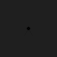

# Generated physical Bogong swarm

The full-duration reference runs the [four-block Selwyn Milky Way/swarm cycle](selwyn-milky-way-swarm-cycle.md): one-time 360 s setup followed by repeating 240/240/240 s conditions, 7 m/s observer, 150 moths per rig and corrected approximately 99% directional order. It measures each animal's mean during the Milky Way-only block and reuses it in both swarm blocks. This document describes the separate original `Examples/Swarm/generated-bogong-speed-distribution.example.json` recipe and rendering/recording tests for its 64-moth population. That recipe and your existing heading-aligned/recorded playback files remain available.

The individual experiment's `stimulus.swarm` creates 64 generated moths **per configured rig**, with no CSV input. The moth remains 3 cm long, 1 cm thick, with a 6 cm coupled wing pair, matching your physical playback settings. `sizeMode: "World"` retains perspective; GPU flapping runs at 30 Hz and subpixel contrast fades with projected area. The sky remains your 0.12 uniform gray during presentation. The near plane is 1 mm, allowing a 1 cm approach. Heading 0 is relative to the frozen animal baseline; kappa is 1000 for yaw and elevation. Existing direction sampling is retained.

| Parameter under `stimulus.swarm` | Recipe | Meaning |
|---|---|---|
| `trajectoryFile` | empty | Generate agents; no replay or inherited recorded trajectories. |
| `numberOfLocusts` | 64 | Count per rig; four rigs give 256 independent moths. The legacy field name also controls moth populations. |
| `density` | null | Optional density used only when count is omitted. In this metre-scale volume, agents/m³. |
| `locustSpeed` | 6.17 | Mean generated speed in m/s here; world units/s generally. |
| `locustSpeedStdDev` | 1.24 | Standard deviation, not variance, in m/s here. Each moth samples once and keeps its speed through wrapping. Negative normal draws are redrawn; at this mean/SD the truncation is negligible. Omitted/zero preserves legacy constant speed and RNG. |
| `volumeHalfExtentMetres` | 2 | Cube from -2 to +2 m relative to the observer on each axis. This physical parameter overrides the configured spawn/boundary sizes, converting to the scene's units. Null preserves older dimensions. |
| `preserveBoundaryOvershoot` | true | Periodic wrapping preserves excess travel instead of snapping to an edge. Large time steps and observer teleports remain within the cube. Omitted/false retains the original wrapper. |
| `spawnRelativeToAnimal`, `followAnimalPosition` | true | Start and retain the volume around the current observer. Individual moths move at their own world velocity; they are not dragged by observer motion. |
| `spawnCenter` | 0,0,0 | No vertical/forward offset from the animal. |
| `wrapY` | true | Wrap all three axes in 3D. |
| `worldUnitsPerMetre` | 1 | Terrain/migration world scale. A centimetre scene uses 100 and scene-native speed values such as mean 617, SD 124 cm/s. |

The observer uses experiment-level `autopilotSpeed: 6.17`, outside the swarm object, during both phases. Matching forward speeds preserve relative separation; speed differences and direction scatter produce overtakes. The boundary follows current position after observer/AGL movement but does not steer existing moths with subsequent yaw. The count stays constant across periodic crossings. This is a synthetic steady population, not an estimate reconstructed from the CSV. At 64 moths in 64 m³, nominal density is 1/m³ and volume-per-animal spacing is 1 m; this is not a nearest-neighbour guarantee.

## Contrast and encounters

`GeneratedSwarmValidation.Run` measures the actual 64×64, 90° rendered pixels against the 0.12-gray background. Full contrast means the difference between background and the configured moth RGB; half contrast means the strongest affected pixel carries at least 50% of that difference. It samples front/broadside views, wing phases and subpixel offsets. The configured half extent is the greater of 2 m and the sampled half-contrast distance. Results are in [validation results](generated-swarm-validation-results.json).

In the native test, the furthest sampled distance meeting half contrast is **1 m**; the sampled poses at **1.5 m** are below it. The recipe therefore uses the requested minimum **2 m** half extent. At 2 m the maximum residual is four 8-bit gray levels out of the full 28-level contrast. The front view can be much fainter than a broadside wing view. These measurements use the physical size and RGB values above, with no contrast boost. Recalibrate if changing dimensions or panel resolution.

At 2 m, some orientations can still leave a faint gray pixel. There is no hard invisibility threshold or artificial pixel/opacity floor. A cube with 2 m half extent has corners 3.46 m away. This pixel test does not calibrate night-level animal acuity or physical panel luminance. At 10 cm, the actual wing geometry changes visibly between up/down phases. Adequate temporal resolution matters: 30 Hz flapping can alias at 30 FPS; 120 FPS supplies four samples per cycle. Hardware frame timing remains in system config and is not changed by this experiment.

The deterministic ten-minute encounter test uses the same unforced random population and co-moving observer. Its counts demonstrate naturally occurring close passes, not an event schedule. Count and volume jointly control density; increasing count raises encounter likelihood. No moth is deliberately steered toward the animal or enlarged for a close pass.

With seed 703 and a co-moving 6.17 m/s observer, that realization has 19 entries within 10 cm, 203 within 25 cm and a nearest approach of 2.36 cm, sampled every 50 ms. It averages 4.35 moths within 1 m. The 100,000-sample speed check measures mean 6.167 m/s and SD 1.236 m/s. Native up/down views of the one coupled wing pair at 10 cm:


Head-on views previously lost both zero-thickness wing sheets. The same two patches now use a thin projected blur edge, equivalent to 5% of body diameter (0.5 mm for this moth), with opacity scaled by its actual pixel coverage. This is a simple blur approximation, not full wing anatomy. It introduces no extra wing pair, minimum opacity or body-size increase. The far proxy uses area-weighted wing/body centroid motion, avoiding the previous body-only wobble when wings were edge-on.




## Recording and performance

Both standalone Swarm and embedded Choice/Selwyn swarms save all presented positions with the existing pooled asynchronous gzip writer. Generated movement runs after observer motion; capture runs after movement, and CSV formatting/compression/disk writes run on workers. There is one shared motion component and one batched renderer per rig, GPU flapping and no per-moth Animator. Steady movement does not resample speeds, recreate objects, read configs or hash files.

The new controls live in the individual experiment JSON files; the original ControlScene metadata form remains. Tests start the generated recipe through that original Save/Start button and check camera allow-lists, physical scale in both metre/centimetre worlds, world-relative motion, exact wrapping and complete coordinate recording.

See [data formats](data-formats.md) for the unchanged nine data columns and world units. Headers now include the speed SD. Archived system/sequence/experiment versions remain in each run's config bundle. The isolated benchmark compares logging off/on for four 64-agent populations and 24 native cameras, verifies zero dropped frames and exact final saved coordinates, and measures main-thread allocation after warm-up. Its CPU submission timings exclude terrain, physical displays and tracker processing; they are not a promise of workstation FPS.

On Apple M2 Pro / Unity 6000.3.16f1, median motion/upload/camera submission is 2.29 ms without recording and 2.45 ms with it; recording capture itself takes 0.104 ms median for all four swarms. Recording-on p95 is 5.27 ms. All 71,680 submitted coordinate rows are present, without drops or worker errors, and final saved positions match every agent. Warmed movement/upload/capture allocates zero managed bytes per frame on the main thread. Your 120 FPS target and hardware layout remain unchanged. Existing recorded playback and five-scene phase suites also pass on the original controllers.

The transferred `heading-aligned.example.json` removes only the accidental duplicate enabled heading assessment inside `stimulus`; its existing `preStimulus` assessment and other edited settings remain. All current templates/examples validate without an exclusion:

```sh
python3 tools/validate_config_templates.py
```

The non-GUI simulation, rendering, configuration and recording updates are on `codex/bogong-night-sky`.
