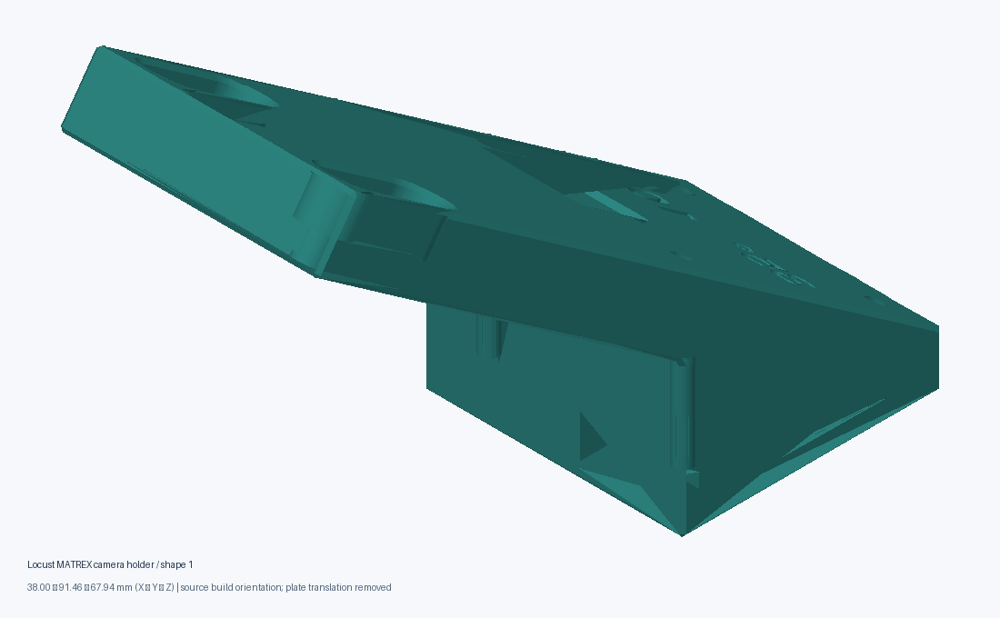
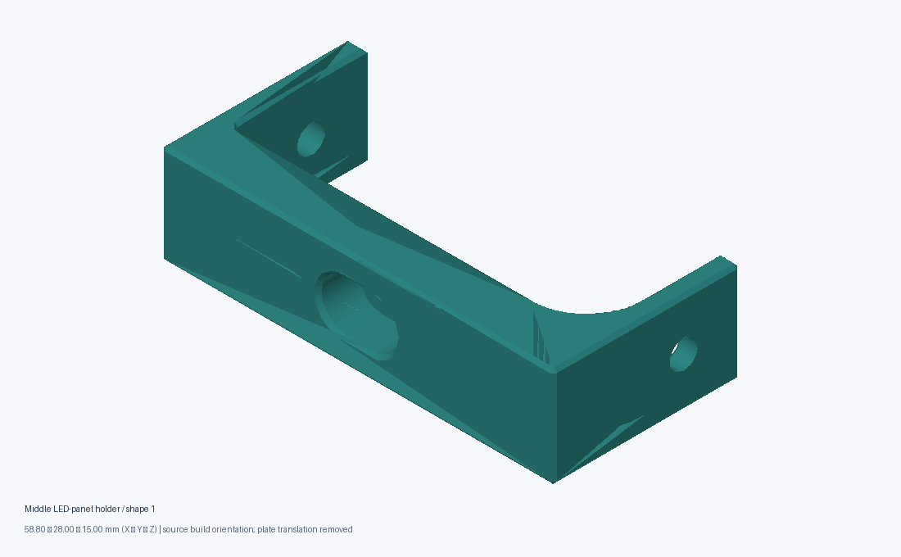
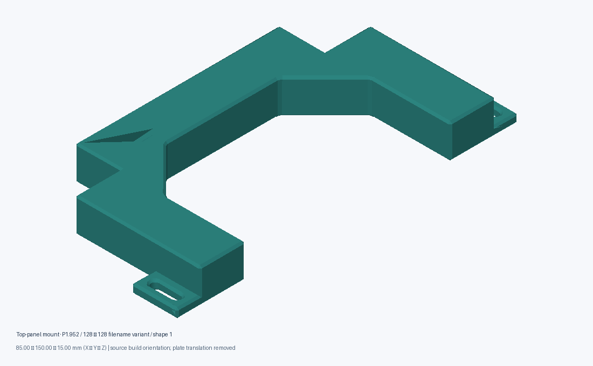
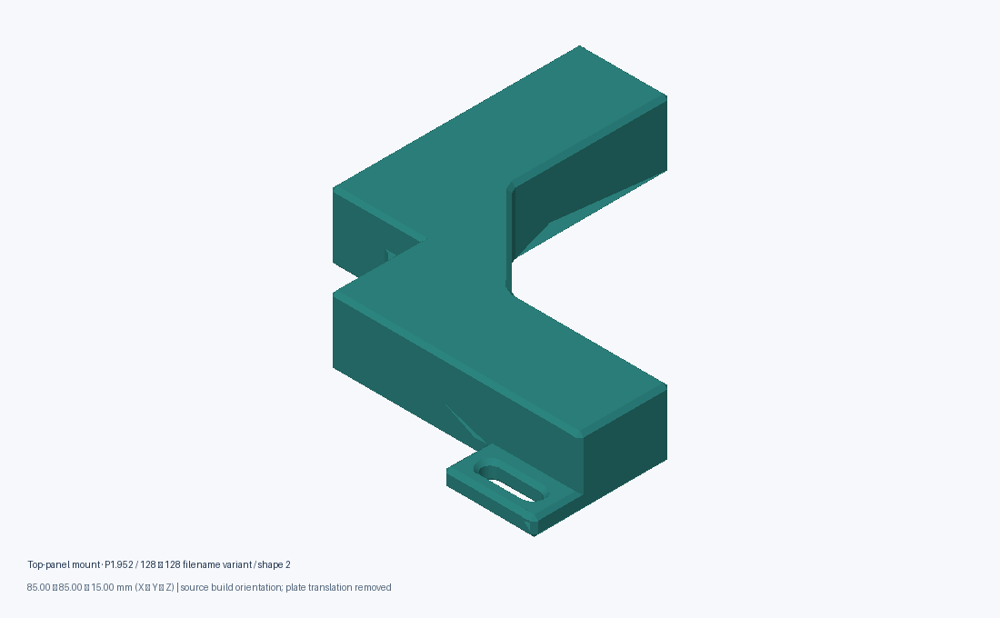
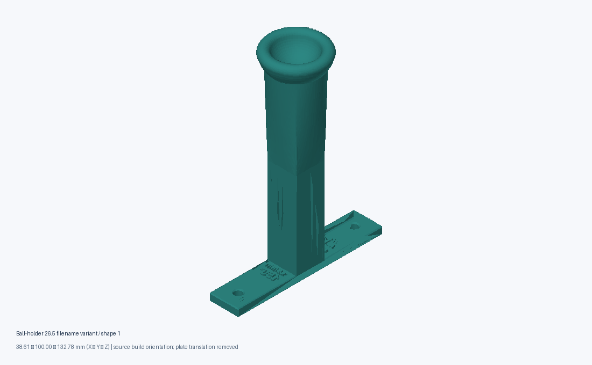
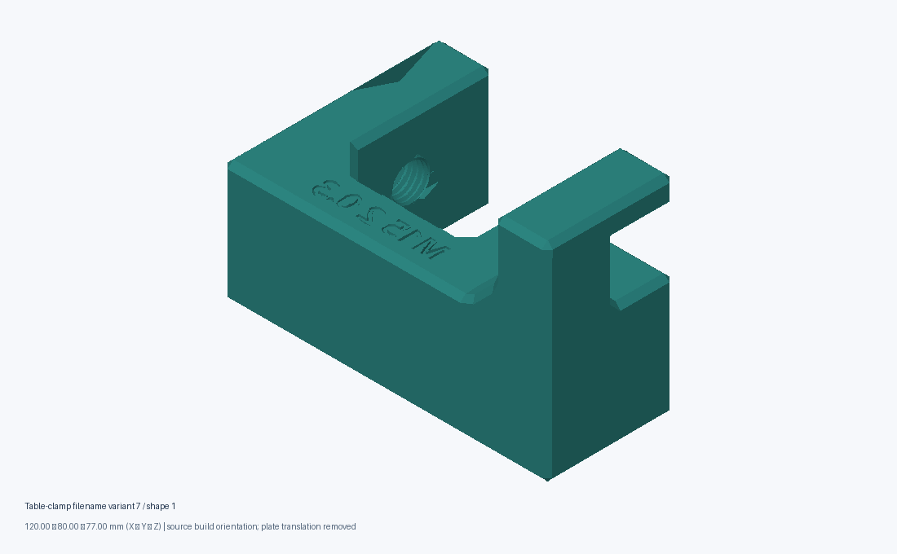
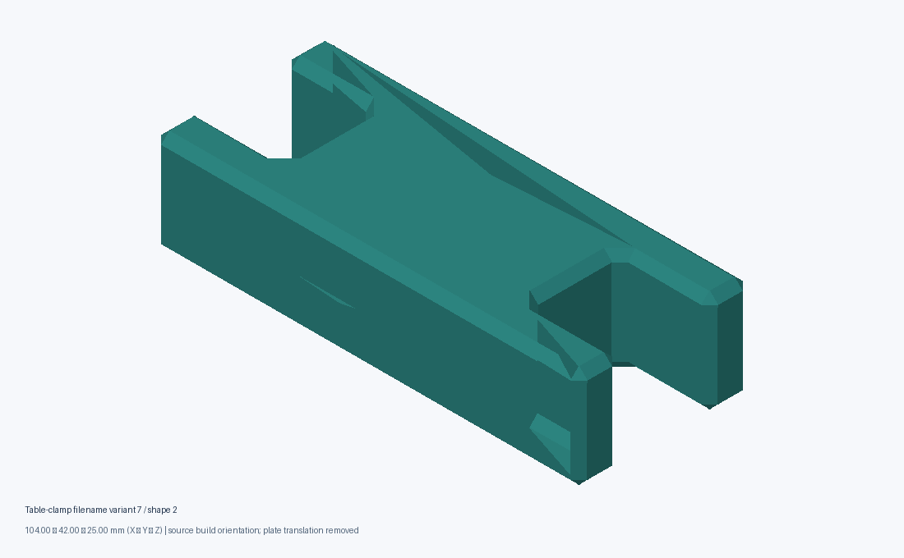
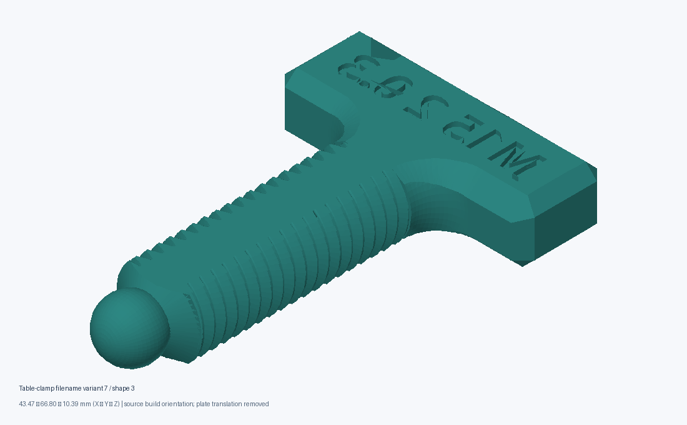
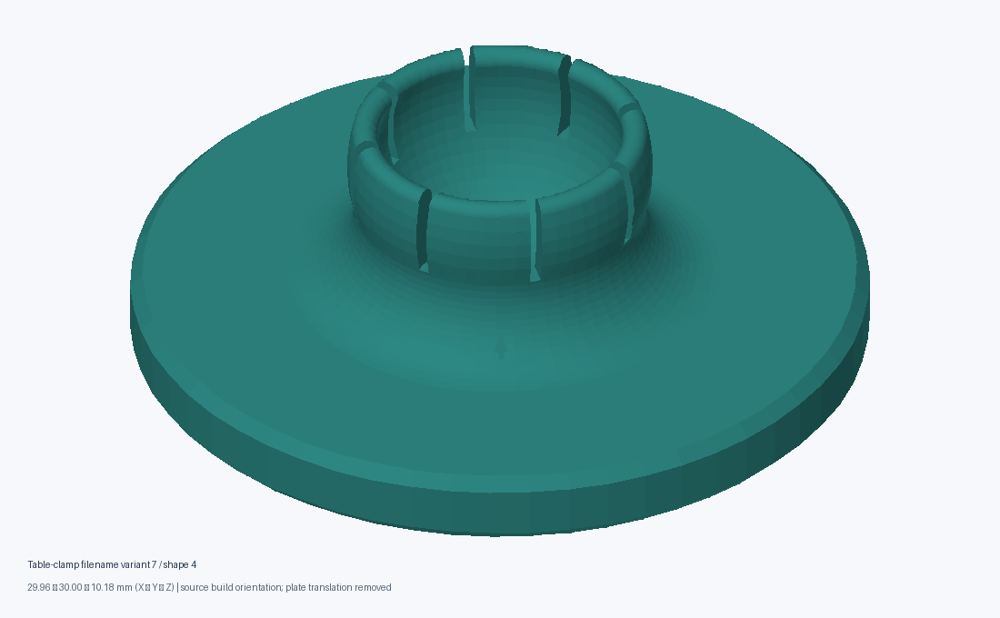

# MATREX apparatus: recovered parts and assembly worksheet

**Local review edition · 1 November 2026.** This is an illustrated identification and dry-fit worksheet, not a mechanically validated assembly manual. Five named source groups were recovered from local Downloads. Their compatibility, final revision, required quantities and redistribution rights have not been established. Do not combine the variants as a complete kit without checking the actual apparatus.

[Part catalogue and individual files](../../docs/site/hardware/index.html) · [Machine-readable inventory](../../docs/site/hardware/inventory.json) · [Software setup](../getting-started.md) · [Display geometry](../six-camera-rig.md) · [Tracker integration](../tracker-integration.md)

## 1. Identify the parts before printing

The catalogue gives every recovered mesh its own identifier, measured X × Y × Z bounding box and file hash. The illustrations below show actual exported triangles. They show source build orientation with plate translation removed; they are not assembly poses. Inspect every shape in multi-shape groups before selecting a part.

### Camera mount

**camera-locust-matrex-01:** recovered from `Part Studio 1 - Camera Holder Locust MATREX.3mf`. The filename explicitly associates this candidate with MATREX and Locust. Confirm the camera body, lens clearance, working distance and mating bracket against your physical instrument. Eight copies on the original plate indicate a print layout, not eight parts required per apparatus.

### LED-panel holders

**panel-middle-01:** recovered from `Led Panel Holder - Middle.3mf`. Determine the panel edge thickness and attachment surfaces from the actual panel and mesh; no screw standard has been inferred.

**top-panel-p1952-01 / -02:** two different shapes from `Top Panel Mount P1.952 128 128.3mf`. P1.952 and 128 × 128 are filename labels, not verified panel specifications. The original plate contains two instances of shape 01 and four of shape 02. These are not established kit quantities.

### Ball support

**ball-holder-265-01:** recovered from `Ball Holder 26.5-2.3mf`. The label “26.5” has not been verified as a ball diameter. The outer mesh is much larger; use the catalogue dimensions and inspect the contact surfaces before choosing a ball or deciding how this support attaches.

### Table-clamp candidates

**table-clamp-01 to -04:** four shapes from `Table Clamp Part Studio-7.3mf`. Numbering identifies export order, not a verified mating or fastening order. Confirm which components belong to the apparatus and the table thickness before loading or tightening the assembly.

## 2. Candidate bill of materials

| Group | Available geometry | Required quantity | Still needed |
| --- | --- | --- | --- |
| Camera holder | One unique mesh | Confirm per tracked station | Camera model, lens, mounting hardware, datum and working distance |
| Middle LED holder | One unique mesh | Confirm from panel arrangement | Panel outline, edge clearance, mating frame and fasteners |
| Top-panel mount | Two unique meshes | Confirm from apparatus | Correct panel revision and relationship between the shapes |
| Ball holder | One unique mesh | Confirm per tracked station | Ball specification, support/contact design and attachment |
| Table clamp | Four unique meshes | Confirm from frame/table | Part pairing, table thickness, tightening limits and hardware |
| LED panels, display interface, power and cables | No verified hardware BOM recovered | Confirm | Panel electrical specifications, wiring and power documentation |
| Camera, host computer, ball and frame | No complete matched procurement list recovered | Confirm | Models, dimensions and supplier references |

No fastener diameters, torque, tolerances or fit allowances are specified by this recovery. Original CAD history and a dimensioned assembly drawing identifying a matched revision are needed to complete the production BOM.

## 3. Units, geometry and editable files

All selected source 3MF models explicitly declare **millimetres**. Component references and nested transforms are resolved before export using the [3MF Consortium core specification](https://github.com/3MFConsortium/spec_core/blob/master/3MF%20Core%20Specification.md). Plate translation is removed independently for each shape, placing its lowest X/Y/Z at zero; source rotation is retained. Repeated identical shapes are collapsed and their original plate-instance counts recorded.

- **3MF:** geometry-only, millimetre-labelled mesh files. Edit in a mesh-capable CAD/slicer application; these do not contain parametric design history.
- **STL:** binary triangles in millimetre coordinates. STL itself has no unit field; import at **1 unit = 1 mm**, 100% scale.
- **Inventory:** original filenames and SHA-256 hashes, shape bounds, vertex/triangle counts, indexed boundary/non-manifold edge diagnostics and export hashes.

Original slicer projects remain in local Downloads. Export packages intentionally omit printer profiles, personal designer identifiers and machine-specific settings. An unmatched `Flexure System.step` candidate is inventoried but not distributed as a verified MATREX source. The Unity `.blend` models are visual assets, not established printable apparatus designs.

Basic checks establish finite vertices, valid triangle indices, readable archives and measured geometry. Indexed edge checks do not certify dimensional fit, mesh self-intersection, load-bearing strength or printing success.

## 4. Printing and orientation review

1. Open one labelled 3MF or STL. Compare its bounding box with the catalogue before slicing; stop if it is 1,000 times too large or too small.
2. Inspect the **source build orientation** shown above. This is evidence of how the file was arranged, not a validated recommendation. Check the contact face, overhangs, bridges, holes and the direction of expected mechanical load.
3. Select material, nozzle, layers, walls, infill, supports and adhesion for your printer and the actual part. No settings have been invented or certified here. Do not reuse unrelated embedded slicer profiles.
4. Preview every layer, including enclosed support or cavities. Confirm that supports can be removed without damaging mating surfaces or camera/panel clearance.
5. Print and measure a representative part before producing the required quantity. Record actual dimensions, fit, material, printer and settings with your chosen revision.

## 5. Proposed dry-fit sequence

The following is a dependency checklist for completing the missing assembly validation. It does not establish that these five source groups fit together.

1. **Establish the frame and table datum.** Identify the intended frame drawing and matched clamp revision. Dry-fit the relevant clamp components to the table without loading the frame. Resolve unknown fasteners and load limits with the designer.
2. **Locate the ball support.** Confirm the ball/support design and frame connection. Establish the animal position as the visual/tracking datum. Check free movement and clearance using the actual ball.
3. **Locate the camera.** Use the matched holder and camera. Confirm focus, field of view and unobstructed tracking at the ball/animal datum before final attachment. Do not infer working distance from the outer mesh size.
4. **Locate the display panels.** Identify the correct holder and top-mount variants. Compare panel dimensions, pixel pitch and connector clearance against the physical panels. Dry-fit each panel around the established datum, retaining camera and cable clearance.
5. **Route cables and verify mechanical clearance.** Confirm connector access and strain relief from the actual hardware. Inspect the whole movement envelope. Electrical wiring and power validation require the panel supplier’s instructions.
6. **Document the assembled revision.** Photograph each stage and record part IDs, quantities, hardware, measured positions, printer settings and modifications. Only then promote a matched set from candidate files to a validated kit.

## 6. Software configuration and calibration handoff

After the physical arrangement is established, follow [installation and first-run setup](../getting-started.md), [six-camera/display geometry](../six-camera-rig.md) and [tracker integration](../tracker-integration.md). Record the measured apparatus dimensions in the appropriate system JSON; printable-file millimetres do not establish Unity world scale or tracking gain.

Initialize/check tracking independently before starting an experimental run. Inspect the correct rig identity, input port, orientation, display routing and fresh input. Use a simple known stimulus to check each panel. Calibrate using the native tracker’s supported procedure and verify the intended visual and navigation scale with your actual apparatus. Saved settings and run metadata should identify the matched physical revision.

## 7. Inputs needed to finish the assembly manual

- The authoritative matched revision and assembly drawing (or photographs identifying every mating part).
- Required quantities, purchased hardware BOM, panel/camera/ball specifications and fastening details.
- Matching parametric CAD sources and a confirmed permission/license for redistribution.
- Validated print settings, fit/clearance measurements, mechanical checks and calibration evidence.

Until those inputs are supplied, use the resources for identification and review rather than treating them as a ready-to-build kit. Nothing in this local review has been externally published.
