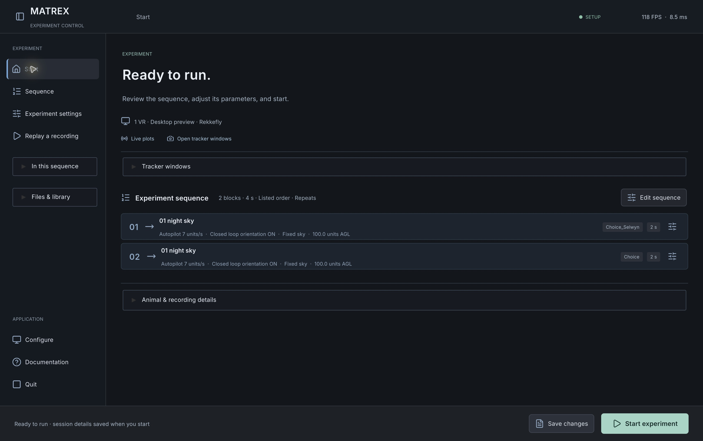

# macOS workflow validation — 26 October 2026

**Accepted software workflow: `75169a2c`, Unity `6000.3.16f1`.** Actual native pointer tests, recording audits, source preservation and live dashboard checks passed within the scope below. Recording manifests do not contain complete application build revisions; recording source identities also use operator observations.

These were webcam/software exercises with **no animal measurement or physical LED validation**. Saved provenance retains `actualInputSource: unverified`. Separately, the native tracker title showed 29.9 FPS on port 9874, and live packet 57980 reported `source_kind=camera`, `source_fallback=false`. The almost-black image contained no animal; this establishes live-camera plumbing, not biological tracking accuracy.

## Recordings and replay

| Run | Raw experiment rows / span | Current importer: rows / contexts / span | Finding |
| --- | --- | --- | --- |
| `20261026_022145` | 214,769 / 1811.909276 s | 214,768 / 4 / 1811.897717 s | Rotation only; exposed autopilot gating. Excludes one idle row and 3,480 failed-replay sidecar rows. |
| `20261026_031046` | 23,606 / 205.373206 s | 23,596 / 10 / 205.363811 s | Five trials × two 20 s scenes; gain 3, autopilot 7, manual keys disabled. Mean within-context XZ speed **7.0011 units/s**. Excludes nine handoffs and one idle row. |
| `20261026_035227` | 10,219 / 110.776208 s | 10,219 / 44 / 110.776208 s | Post-fix `dab56e82`: 22 trials × two 2 s scenes; **zero scene/sequence mismatches, idle rows or reader exclusions**. Median within-context frame speed **7.0003 units/s**. |

All retained contexts resolve to saved configurations. All three runs have 55-column pose rows without malformed/nonfinite values or reversed/duplicate timestamps and frames. The first experiment log has contiguous frames. The 20 s run has nine one-frame omissions at scene changes (0.506–0.715 s loading gaps). The 2 s run has 43 transitions, each omitting two gated/loading frames (86 total; 0.511–0.616 s gaps). Their largest frame intervals are 1.012 s and 1.216 s respectively; constant 120 Hz operation is not claimed.

Each run’s four config snapshots/readable copies and 4096×2048 skybox PNG passed hash/size checks. The fresh run has 44 sky applications and no ReplayScene CSV. After final replay returned Home, all 23 source files in `031046` remained byte-identical. In `035227`, all 21 acquisition/config/sky files and the manifest matched; only the previously observed 61-byte shutdown trace append differed, with its original prefix matching. Neither session had added/missing files or concurrent writes during comparison.

Handoff/idle exclusions require explicit modern context and a verified saved sequence. Reserved setup/replay sidecars are excluded separately, including legacy filename fallback. Uncertain legacy aliases remain untouched; wall-clock, unlogged-animation and tracker-validity limits remain disclosed. Acquisition files are preserved.

Actual native player capture from `8b3287a0`, before the final replay toolbar revision.

## Actual manual observations

- Configure typing, expanded VR2→VR5 rename, port 9892 and vertical packing retained scroll/foldout state. Actual Start produced the three recordings.
- On `8b3287a0`, duplicate changed 2→3 blocks and 4→6 s, with matching header/overview and row 03 Choice selected. Remove restored 2 blocks / 4 s and row 02 Choice selected.
- On accepted `75169a2c`, Pause/Play worked; forward scrub moved 41.0→83.0 s (trial 16 Selwyn), reverse reached 32.4 s (trial 6 Selwyn), then playback resumed at 32.9 s. Default God-eye, Animal VR1/Fit switches and visible fidelity notes passed.
- The app-owned native folder panel appeared in fullscreen. Cmd+Shift+G to `031046`, then Open, loaded the 205.3 s recording. Reopen/Cancel preserved folder, time and paused state and reenabled controls. Back returned Home.
- Live plots launched native DaariDeepa (PID 54224, parent PID 1); reopen created no duplicate. Plots showed heading arrows, signed heading, context and units. Pause held 75 samples across the next trial while acquisition continued; Resume showed 116 samples/current context.
- During final replay, the viewer stayed stale on prior session `071158`. Back resumed receiving session `20261026_073154`, ControlScene idle, 120.0 FPS and 576 displayed samples; the publisher worker resumed.
- Quitting Unity left both companions running. Quitting the tracker left Unity and dashboard running. These are direct observations, not CSV inferences.

## Reproduced bugs and fixes

| Finding | Source fix |
| --- | --- |
| Repeated fullscreen geometry requests. | `ca95c288`; not established as the replay pointer failure’s cause. |
| Delayed-field commit swallowed the first click. | `38e3efbb`, `41517bb5`: deferred rebuilding and pointer-release recovery. |
| Draft Start rejected setup; sequence errors blocked hardware completion. | `11322654`, `8bb9e355`: configuration action and hardware-only validation. |
| Per-rig output and CLI/global fallback disagreed. | `7e7f1cc7`, `b98d3389`, `8bb9e355`: consistent routing/validation. |
| Disabled keyboard controls stopped autopilot. | `b738fb05`; movement verified above. |
| Missing replay components and sidecars corrupted playback context. | `891880f9`, `ee86c6ea`: fail-closed reconstruction and sidecar exclusion. |
| Outgoing-scene metadata created false contexts. | `039b2303`, `ef9bba78`: producer gating and conservative reader filtering. |
| Sequence totals/selection and replay layout needed correction. | `381fe9a5`, `ee4be416`, `dab56e82`: derived UI, selection and native-pixel layout. |
| Replay could feed live acquisition telemetry. | `55ecc76c`: ReplayScene pose/context suppression; resumption verified above. |
| Earlier event restoration, fast drags and hidden folder dialogs failed. | `2494d882`, `4847175a`, `75169a2c`: root-clip controls, final-state scrub completion and app-owned native panel. Final manual tests passed. |

The accepted combined-run log has 221 lines and no exception/error/assert/failed/fatal/crash/timeout matches; existing missing-Behaviour warnings remain. Final observed state: player open at Home, camera off, independent dashboard receiving setup status.

**1034 supporting checks passed: 880 across 10 scripts + 67 telemetry/replay policy + 72 replay UI + 15 native-picker checks**; the batch includes 150 writer lifecycles. Earlier failed attempts remain historical findings, not current failures. No requested manual checks remain outstanding within this Mac software-validation scope.
