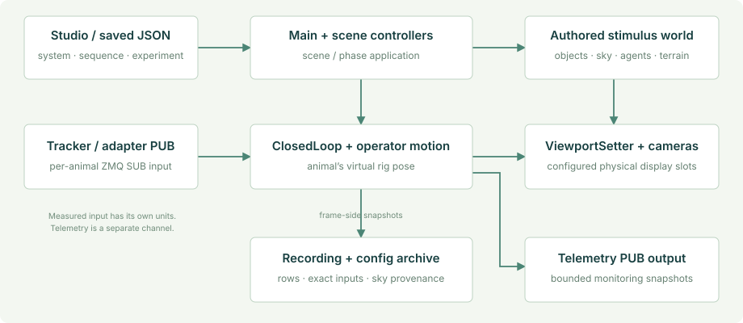

# Runtime architecture

The application has one operator/sequence layer, scene-owned experiment controllers and per-animal rigs. Tracking, presentation, monitoring and recording communicate through explicit state; they do not all run on the same worker or share a single ZMQ port.

*Schematic of ownership and channel direction, not a timing trace or hardware wiring diagram.*

## Ownership at a glance

| Owner | Responsibility | Lifetime |
| --- | --- | --- |
| `MainController` | System config, sequence order, trial/step clocks, scene transition, tracking registration, saved heading references | Persistent across normal scene changes |
| `MasterDataLogger` | Session directories, exact consumed inputs, trace, writer-drain/archive boundary | Persistent; starts a fresh session from configured setup |
| `ConfigWorkbench` | Session form, system/sequence/experiment editing, validation and Start | Control/setup only; its panel is destroyed for an experiment |
| Scene controller | Choice objects/design, Swarm, Kannadi, Optomotor or terrain-specific stimulus application | Current scene; compatible controllers can reconfigure in place |
| Rig components | Input reception, measured movement, manual movement, camera mapping and animal pose logging | One configured rig in the experiment scene |
| Night-sky controller | Generated/explicit sky, activation provenance, resource cleanup | Managed stimulus context |
| Telemetry/status UI | Bounded sampled diagnostics, live operator state and errors | Independent of the setup panel and overview |
| ReplayController | Saved-run timeline, evidence resolution, replay views and supported environment/population reconstruction | ReplayScene |

## Startup and setup

RuntimePaths selects the configuration and recording roots. In a player it copies **missing** bundled configuration files into the writable profile. Existing user files are not replaced. In the Editor, defaults remain StreamingAssets and Assets/RunData.

MainController establishes its singleton, ensures that MasterDataLogger exists, reads the system/sequence configuration and registers scene-load handling. The default 0.3 sequence has `autoStart: false`, so a fresh profile enters the studio. `-configure` also forces setup. An existing user file can intentionally retain auto-start.

MasterDataLogger captures the system and sequence graph before experiment loggers begin. The studio may then rotate into a fresh configured session when Start is pressed. It saves the selected documents, records their exact sources and metadata, and hands execution to the existing runner.

## Scene transition boundary

MainController selects the next execution-order entry. A real scene load runs the new scene's controller, configures its rigs and applies the experiment. RuntimeRigRegistry reconciles the configured `VRn` identities with the authored rig template before their tracker Start callbacks open inputs.

For a compatible **same scene** with `reloadScene: false`, the runner calls `IInSceneSequencer.AdvanceStep(parameters)`. This avoids loading the scene again while still rebuilding/reapplying the condition. It does not mean that all prior trial resources may remain allocated. Population/material cleanup remains the controller's responsibility.

A change of scene or an explicit `reloadScene: true` follows the full-load path. The [scene lifecycle guide](../scene-lifecycle.md) explains owned resources and the crash investigation's actual evidence.

## Frame-side work and workers

| Execution context | Work |
| --- | --- |
| Unity frame thread | Scene/rig transforms, stimulus configuration, rendered cameras, immutable snapshot capture and most Unity object creation/destruction |
| Tracker receive worker | SUB socket, payload validation and a locked latest-sample handoff; the worker owns socket disposal |
| Telemetry publisher worker | JSON encoding and outbound PUB operations using the latest bounded pending snapshot |
| Swarm recording worker | Buffered population formatting, gzip and file writes; clean shutdown drains before ZIP creation |
| Replay loading/indexing | Saved evidence parsing/indexing; Unity object application remains in the replay's frame-side flow |

Do not call Unity rendering APIs from an arbitrary socket or file worker. Do not let a network subscriber back-pressure the experiment frame loop. Telemetry can drop snapshots; recordings and their dropped-frame diagnostics have their own contract.

## Motion and experimental phases

ClosedLoop consumes the newest complete tracker sample and applies the selected walking or flight interpretation. Keyboard adds permitted operator/autopilot movement. Optional RugosityRig owns height/normal alignment after horizontal movement; MigrationMotion retains its specific wind/AGL role and yields where rugosity owns the pose.

ExperimentPhases manages enabled preStimulus, stimulus and postStimulus conditions in one scene. Phase clocks begin after their configuration/sky setup completes. Heading windows are bounded to the scene or phase duration rather than lengthening the condition. Heading observations use the animal's virtual yaw; raw flight control input is not the measured heading.

## Trace one failure

Configuration validation can stop Start before a presentation begins. A missing consumed snapshot makes the archive incomplete. Scene/phase application exceptions enter the runner's error state and report through the status overlay and trace. Telemetry bind/send failures are monitoring failures and do not certify that stimulus execution recovered.

Use `runtime_trace.log` together with the current phase, config manifest and Unity Player log. A visible error panel records a failure; it is not an automatic experimental validity decision.

## Source map

- [MainController](https://github.com/pvnkmrksk/matrexVR/blob/main/Assets/Scripts/MainController.cs)
- [MasterDataLogger](https://github.com/pvnkmrksk/matrexVR/blob/main/Assets/Scripts/Loggers/MasterDataLogger.cs)
- [RuntimePaths](https://github.com/pvnkmrksk/matrexVR/blob/main/Assets/Scripts/RuntimePaths.cs) and [RuntimeRigRegistry](https://github.com/pvnkmrksk/matrexVR/blob/main/Assets/Scripts/RuntimeRigRegistry.cs)
- [ExperimentPhases](https://github.com/pvnkmrksk/matrexVR/blob/main/Assets/Scripts/ExperimentPhases.cs)
- [ConfigWorkbench](https://github.com/pvnkmrksk/matrexVR/tree/main/Assets/Scripts/ConfigurationUI)
