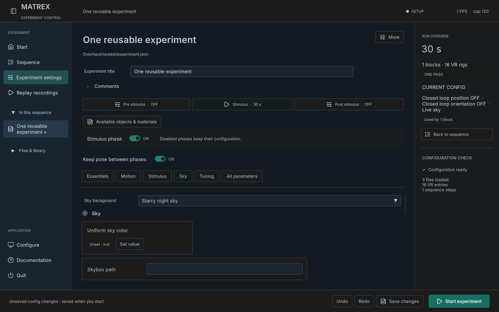
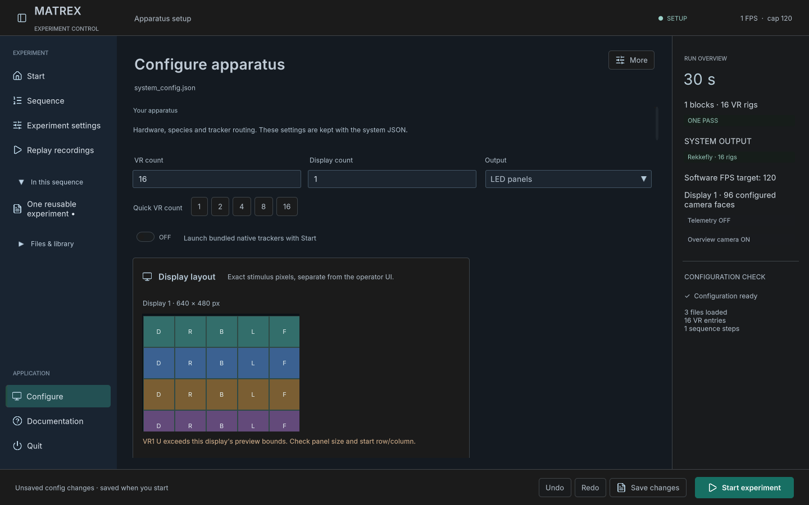
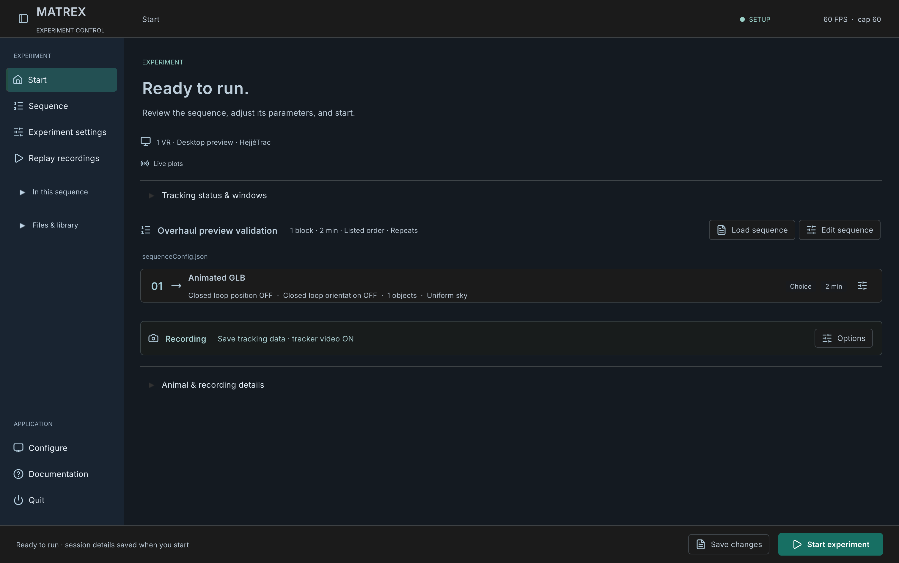

# Overhaul validation — 29 October 2026

This records the earlier overhaul pass. The later greenfield replay architecture and setup refinements are governed by the [same-build replay contract](same-build-replay-contract.md); the [new validation report](same-build-validation-20261029.md) supersedes the replay limitations below.

Development branch: `codex/experiment-replay-overhaul`, Unity 6000.3.16f1. The [requirements and priorities](overhaul-0.5-plan.md) distinguish implemented behavior from follow-up work. [Machine-readable evidence](overhaul-validation-20261029.json) records suite counts and local report locations.

## Verified software behavior

| Check | Result and scope |
| --- | --- |
| Rigs/worlds | 1,728 Unity checks: Kannadi at 1/2/4/8/16; every enabled experiment world at 16; six 90° faces, isolated layers and peer visibility; real GLB/material/clip import and archived-byte recovery; supported retained shaders; sun controls. |
| Animation/replay | 359 Unity checks: original locust controller and deformed mesh/bones, forward/reverse/pause, procedural wing/flicker clocks, imported GLB clips, CSV animation evidence/cache, source hashes and replay peer masks. |
| Actual record → replay | 998 checks across two recorded scenes, dynamic stimulus changes and backward scene/stimulus seeks. Worst mean RGB error in six tested views was **0.0122%**. Explicit synthetic native-format JSON PUB at 120 Hz; no animal/camera input. |
| Phase continuity | Actual 16-rig PlayMode acquisition: Swarm alias loads Kannadi, all three phases recorded, same scene/rig instances and translated poses retained, unchanged post-stimulus mirror instances retained, reset true restores authored poses, all 16 saved pose streams reopen. No Unity errors. Original runner recorded repeated tick invariants; report uses **106 distinct assertions**, not the inflated repeated count. |
| Seeds/groups | 524 Unity checks: same fixed seed and named streams repeat, independent object initialization order, random resolved seed persisted, no seed overwrite, no RNG evidence writes after recording ends, atomic pairs/triplets and loop boundaries. |
| Configuration GUI | 42 Unity checks and actual dark GUI captures: readable titles/paths, phase creation/continuity, 16-rig validation and editors, seed controls, four skies, current-time disabling and fractional UTC offsets. |
| AI control | 10 Unity PlayMode checks plus 6 Python protocol/transport tests: production validation, immutable source files, dirty-draft refusal, idempotent idle stop, expiry and recording-directory exclusion. |
| Static/regression | 442 world/catalog checks, 106 JSON template/example checks, 622 archived hashes, 979 preserved historical inputs and asset GUID/dependency checks. Existing focused suites passed: archive/writer 677; compatibility 58; apparatus 55; logger handoff 16; seal 16; replay isolation 15; native replay layout/pointer math 80; recording summary 66. Controlled-method suites are separate from native pointer acceptance. |

## Standalone Mac check

The separate `.local/MATREX VR Overhaul.app` builds as `0.5.0-dev`, with verified existing native companions and no publication. A separate test config/data/control directory was used. Actual local MCP requests validated and started the saved configuration through the GUI workflow. The player rendered a green imported GLB triangle with its embedded vertical animation; its original bytes were archived exactly. Native keyboard input hid overlays, stopped to setup and quit normally. This establishes the runtime shader/import path on this Mac; it does not establish every glTF extension/material on every platform.

CUA screenshots worked, and keyboard control worked after raising the app. Pointer actions reported `noWindowsAvailable`; a complete native pointer/drag stress test is **not** claimed. Source form/render tests and pointer geometry tests passed separately.

Native testing exposed a remembered low render resolution: `Screen.currentResolution` returned 1440×900 while the actual display reported 3024×1898. Startup now uses the window's display dimensions, with a current-resolution fallback when display metadata is unavailable. **77** desktop coroutine checks and **6,428** overlay-layout assertions passed. The final standalone diagnostic confirms a **3024×1898 framebuffer, 2× UI scale and 1512×949 logical setup space**. The final native MCP validator also accepted historical `Swarm` sequence JSON through the Kannadi alias. Final code build: `12c49ec6`, zero errors; warnings are retained in the local build log/report.

## Remaining boundaries

* Historical recordings cannot supply animation, random phase, orientation or events they never recorded. Animator state/time/parameters are restored; transition blending and consumed trigger state can still be approximate. Configured static-object clips use their declared replay clock rather than a complete per-frame world-animation journal.
* A seed controls the application's owned stochastic streams; variable frame timing, physics, external tracking and third-party scripts do not become bit-identical solely from that seed. Recorded poses, animation and event evidence remain authoritative.
* Runtime import accepts self-contained GLB 2.0. Vendor Unity packages, raw FBX and external dependencies require export/conversion. Material extensions beyond the checked importer path need their own verification.
* Tiny rendered model/sky picker previews, optional panorama azimuth, arbitrary visibility matrices, broader UI redesign and measured large-video/cache tuning remain ordered follow-ups. The five world starters reuse existing assets; the flat base is textured grass/dirt, not new desert artwork.
* Acknowledged bidirectional recorder start/stop with HejjéTrac/Rekkefly, physical calibration/LED timing, sustained 16-rig performance, all-count native mouse acceptance and native Windows/Linux walkthroughs remain apparatus/platform work. Existing companion launch/monitor behavior is retained; this pass does not establish those hardware outcomes.

## Reproduce

Use `tools/build_local_desktop.py --prepare-only` to make a disposable project with the `KANNADI_VALIDATION_COPY` sentinel. Run the installed Unity Editor with `-batchmode -projectPath <copy> -executeMethod <suite>.Run -logFile <log>`; omit `-quit` because the suites exit themselves. Suites: `RigWorldValidation`, `ReplayAnimationValidation`, `SeedSequenceValidation`, `OverhaulConfigurationValidation`, `KannadiPhaseValidation`, `ExperimentControlValidation`. The real record/replay comparison uses `tools/run_replay_roundtrip.py` with a labelled synthetic publisher, or explicitly identified external native input. Never run destructive validation fixtures against the source project or real acquisition files.
