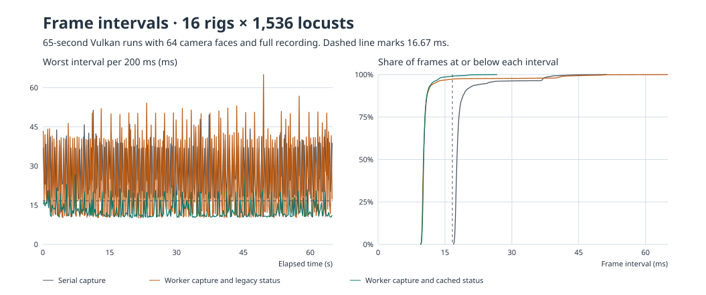

# Worker population capture and operator status timing

This follow-up starts from the final 0.4.2 recording and rendering pipeline. The test workload used 16 Kannadi rigs with 1,536 stock locusts per rig, four 128 × 128 stimulus faces per rig, and fixed synthetic movement. The host was an i9-13900K with 32 logical CPUs and an RTX 4070, running Unity 6000.3.16f1 with Vulkan. Each comparison ran for 65 seconds after startup. The benchmark suspended the idle setup player for each case and resumed it afterward. No live tracker or physical LED timing was measured. [Earlier results](performance-history.md) · [Intervals, CPU samples, and commands](population-worker-results.json)

| 16 × 1,536 workload | FPS | Capture mean | Frame median | Frame p99 | Frames over 33 ms | Seal |
| --- | ---: | ---: | ---: | ---: | ---: | ---: |
| Existing per-agent capture | 53.24 | 8.48 ms | 17.69 ms | 38.84 ms | 128 | 1.36 s |
| Worker capture, existing status overlay | 89.67 | 0.62 ms | 10.18 ms | 41.63 ms | 129 | 2.04 s |
| Worker capture, overlays hidden | 80.44 | 0.78 ms | 10.40 ms | 60.10 ms | 178 | 1.91 s |
| Worker capture, registry-backed status overlay visible | 95.09 | 0.62 ms | 10.22 ms | 16.39 ms | 0 | 2.17 s |

## Capture path

The previous pose jobs distributed position and rotation reads. The main thread still visited each live Unity object for hierarchy visibility, scale, and animation snapshot assembly. The fast path binds a fixed roster of independent generated stock locusts to the already baked animation playheads. Jobs sample positions and playback state in native arrays. The main thread copies packed samples to a leased recording frame, and the existing per-rig writers assemble the animation rows and serialize them. Each stock group has immutable identity data, initial Euler rotation and lossy scale. Membership events invalidate the roster if a locust is disabled, moved to another parent, or destroyed. A changed rotation or local scale switches that logger to exact generic capture before it records the affected frame. Other models and dynamic populations continue through the existing capture path.

The .matpop file layout and seek/export tools are shared with the previous writer path. Unity's population snapshot suite passed 471 checks, including byte equality for stock and generic packets, lifecycle changes, negative and zero scales, and pooled frame reuse. The live verification mode compared all 24,576 rows against Unity on each of 268 measured frames. The registry-backed run wrote 160,407,552 population rows by the end of the timed sample, dropped zero population frames, and reported no writer failures. Its peak pending depth was at most one frame per writer. The elapsed seal time includes stopping and writing the final manifest. Faster runs write more rows during the same wall time.

## Half-second hitch and remaining limit

The original overlay looked through the global Unity object registry four times at each dense status refresh. With worker capture enabled, 125 consecutive gaps between frames exceeding 33 ms fell between 490 and 520 ms. Two slow frames coincided with a garbage collection. A same-build run with the overlay hidden and all logging enabled eliminated that half-second pattern. That run also had separate clusters of consecutive slow frames with no clear cause in the available samples. Its lower mean is retained in the table.

The replacement status overlay tracks live spawners and recorders as they are created and removed. It computes the same totals from those small collections. With the overlay visible, the 65-second retest had zero frames over 33 ms and 59 over the 16.67 ms frame budget. The previous 5–10 second report and this measured half-second pattern are different observations. The follow-up data records the exact intervals for comparisons.

The process averaged 9.95 logical-core equivalents, or 31.1% of the 32 logical CPUs, compared with 5.26 equivalents in the serial capture control. The Unity main thread was near one full logical core. The sampled population writer threads used about 2.12 equivalents together. The job workers distributed additional work across the remaining cores. Main-thread frame timing averaged 10.51 ms, versus 3.58 ms for the GPU and 2.41 ms for the render thread. The largest measured script stages left were swarm motion and draw submission. More CPU capacity is available, but the measured render throughput still depends on work that has to complete on the main thread before it can hand off the next frame.

## Rendering-only capacity

These 65-second diagnostics turned off animal, world, and population recording while keeping the same rig layout and rendered motion. They locate the 60 FPS mean-throughput crossing between 2,560 and 3,072 locusts per rig for this particular scene and host. The high-density production preset remains 64.

| Locusts per rig | Total agents | FPS | Frame p99 | Main mean | GPU mean |
| ---: | ---: | ---: | ---: | ---: | ---: |
| 2,560 | 40,960 | 66.75 | 23.15 ms | 14.98 ms | 5.50 ms |
| 3,072 | 49,152 | 55.67 | 26.95 ms | 17.96 ms | 6.49 ms |

Run comparisons with `--performance-probe`, the supplied 16-rig BLFR system, and the `referenceTightSwarm` recipe from the [earlier evidence](performance-history-results.json). The worker control flag is `--serial-stock-population-packets`. The exact stock verification flag `--verify-stock-population-packets` deliberately visits the Unity objects again for checking. For controlled overlay investigation, `--legacy-status-overlay-scans` restores the previous discovery behavior in a probe. Use `--performance-phases all-evidence-off` for the logging-off diagnostic. The full per-case arguments and build GUIDs accompany the measurements.
