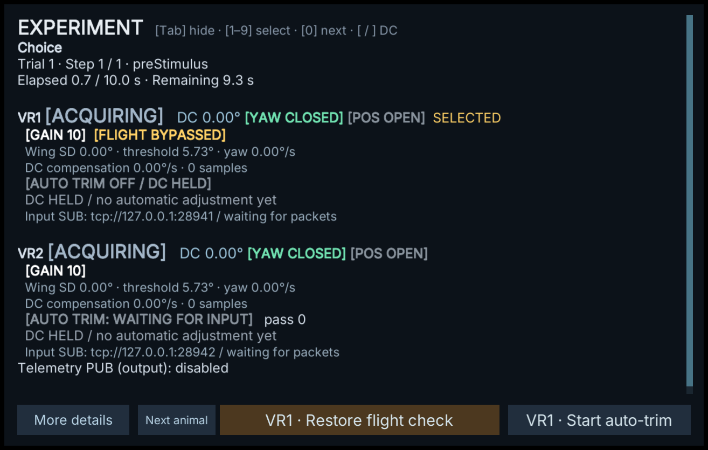
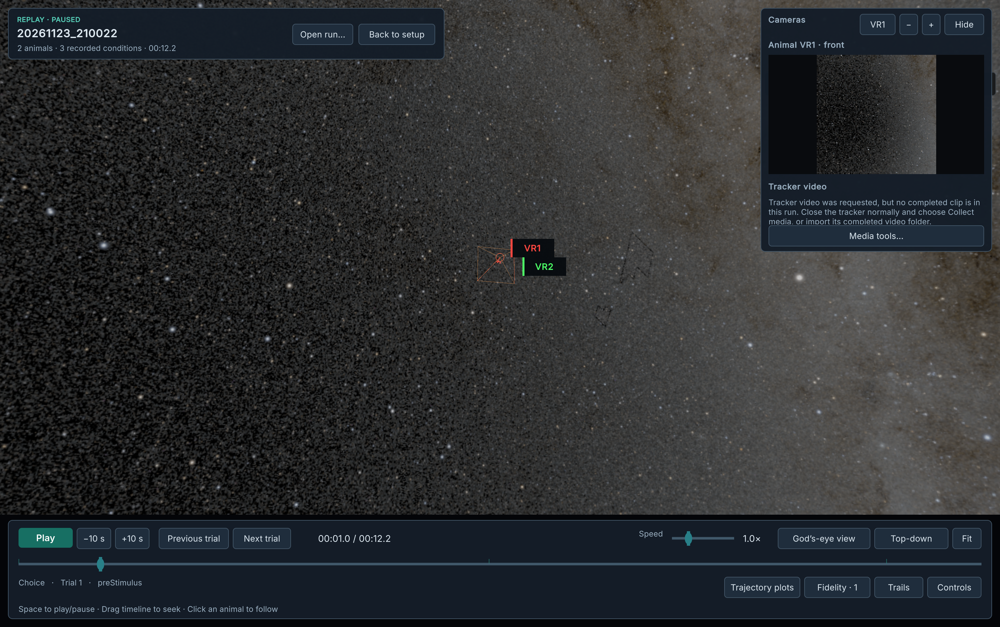

# MATREX VR 0.4.5

## Selective auto-trim

Open **More details** in the run dashboard and select a single rig. **Start auto-trim**, **Stop auto-trim**, and the flight-check override apply to that rig. A repeated trial starts with the authored configuration. Each rig keeps its learned DC offset.

## Star sky replay

Replay restores the archived panorama for the selected recorded frame. In **God’s-eye view**, switch to **Perspective** and tilt up or rotate to inspect the sky. Seek across phases to see the saved skies change.

Screenshots are from a local macOS Preview with a synthetic two-rig configuration. Keep the original player alongside recordings that require that build.
