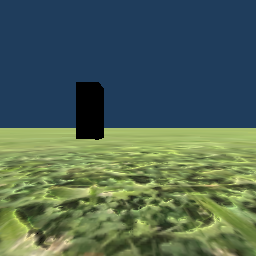
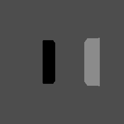

# Recording → replay verification

The current-source replay path was tested by running **Choice and Choice_desync for four seconds each**, with tracking supplied through a real 120 Hz local ZMQ PUB. The fixture is explicitly synthetic; no camera measurements or animal behavior are represented by these examples.

The normal MainController and DataLogger wrote the saved run, its immutable configurations and sky image. The actual ReplayScene reopened that folder. Tests sought forward, through the recorded color swap, backward through it, and backward across the scene boundary. No tracking listener was started by replay.

## Measured result

[The machine-readable report](replay-roundtrip-validation-results.json) records 992 checks with zero runtime errors. All four sampled acquisition frames have the matching recorded position and orientation. Six 256×256 animal-camera comparisons have mean absolute RGB error from 0 to 0.0158%. This is evidence for the two tested scenes/configurations, not pixel identity for arbitrary historical scenes or hardware.

| Source view | Replay view |
| --- | --- |
|  |  |
|  |  |
|  |  |

These are unmodified Unity renders. Image hashes are retained in the report.

## Defects corrected

- The replay scene's convenience light illuminated the imported experiment again. Suspending it removed a measured 10.8% discrepancy in the first comparison.
- The replay animal camera used an arbitrary field of view and stretched aspect, and could see the overview markers. It now uses the built front camera's projection and saved panel aspect when available; overlays stay in God's-eye view.
- Dynamic swaps were ignored and asynchronous conditions could be absent when the loader first reported ready. Recorded event state now drives reconstruction in both seek directions.
- Adaptive trial names were generated at runtime and therefore did not match the saved template's name. Recorded black side, learned gray value and control kind now select the saved template without rerandomizing.
- Pre-manifest files used names such as `<session>_ControlScene_Choice_00.json`, while the resolver searched only `Choice_00.json`. A unique saved content version now resolves correctly. Conflicting versions remain an error.
- Machine-culture floats and unquoted names could shift rig CSV columns. Current recording is invariant/quoted and replay rejects inconsistent legacy row widths. Regular pose capture occurs after movement in LateUpdate and includes `unityFrame`.

A read-only inspection of an existing local 2025 run loaded 115,157 animal rows across two animals, resolved all six recorded configuration contexts, and indexed 248,199 rows in one representative population recording. The original dataset was not changed. It lacks saved system JSON and trustworthy visibility flags, so exact display calibration and blinking remain unavailable.

## Remaining evidence boundary

New Band rows include the actual `Visible` state. Historical `VisibilityPhase` used a global clock while rendering used a local timer; treating it as exact blinking would be misleading. Unrecorded animation, randomized rotations, historical asset changes and missing sky/system files still cannot be reconstructed exactly. The fidelity panel preserves those limitations.

## Reproduce

Use a disposable project with `KANNADI_VALIDATION_COPY` at its root. The runner replaces only that copy's test configs and writes its run under the requested output folder.

```sh
python tools/run_replay_roundtrip.py \
  --project /absolute/path/to/disposable-project \
  --output /absolute/path/to/new-output-folder
```

The development runner requires pyzmq and the matching licensed Unity Editor. Add `--external-publisher --port PORT` to use an already-running native tracker instead of the labelled synthetic PUB. Select `--backend Hejjetrac` for native FT walking input. External input can be stationary; it must still supply fresh valid pose packets. Do not use the original working project or a data directory containing experiments.

Offline archive/writer/evidence regressions:

```sh
python3 tools/test_replay_archive.py
python3 tools/test_replay_archive.py --inspect-run /path/to/legacy/run --report /path/to/summary.json
```

The inspection command reads the recording and places transient indexing data in a temporary cache; it never rewrites its configuration or recordings.
