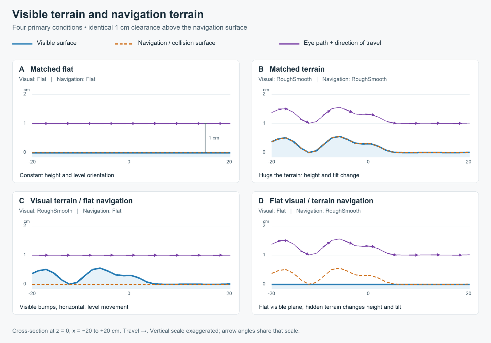

# Terrain cue lab: separate visual and navigation rugosity

Use the four **TerrainChoice** spatial layouts and the treatment sequences below for the choice experiment. Scene identity, spatial terrain pattern, and experimental condition are separate concepts. Each new scene is a thin instance of the same shared environment prefab; trees, material, mesh references, controller and standard configured camera rig are edited once. Existing RS/navrug scenes are not renamed or repurposed. The earlier `Assets/Scenes/Rugosity_RS.unity`, its GUID, meshes and six choice files remain unchanged and runnable with `Examples/Rugosity/sequence-legacy-rugosity.json`.

The [sixteen-case visual audit](terrain-matrix-visual-review-20261027.md) verifies the actual camera renders and mesh/navigation assignments, including exact 128×128 frames. It also documents that the photographic texture masks the small geometric relief: correct routing is not a claim of strong perceptual visual contrast. The four both-flat controls intentionally remain identical. New surface IDs paired with the stock legacy `Rugosity_RS` scene now produce a pre-start configuration error.

The Bogong night-sky improvements were already inherited on this branch. The terrain work adds optional behavior; scenes without an enabled RugosityWorld keep their original movement behavior.

## The four primary conditions



[Vector schematic](terrain-cue-four-conditions.svg). The figure uses **actual Unity mesh samples and rig poses**, exported by `RugosityValidation`, rather than a separate idealized drawing. Blue is rendered terrain; dashed orange is navigation/collision terrain; purple arrows show eye position and the forward direction as the agent moves from left to right. The vertical scale is exaggerated. The clearance is vertical, not measured along the normal.

| Condition / choice file | Visual surface | Navigation surface | Agent behavior |
| --- | --- | --- | --- |
| `matched-flat.json` | Flat | Flat | Fixed height, level orientation |
| `matched-terrain.json` | RoughSmooth | RoughSmooth | Follows terrain height and normal: the canonical ant walk |
| `visual-terrain_navigation-flat.json` | RoughSmooth | Flat | Sees bumps, moves horizontally with level orientation |
| `visual-flat_navigation-terrain.json` | Flat | RoughSmooth | Sees a plane, rises/falls and tilts with hidden terrain |

All four use `AboveGround` height, `SurfaceNormal` orientation, **1 cm clearance**, and no spatial or temporal normal smoothing. A flat navigation surface naturally has a constant normal; the same controller can therefore be used for all four conditions. The last two change only the geometry assignments. Pitch moves a flat horizon vertically and roll tilts it; these are distinct from irregularities in a visible terrain silhouette.

“Looks rough / feels smooth” is shorthand for the third condition. Here **navigation rugosity** means the movement of the camera rig; perceived roughness remains an experimental outcome.

## Spatial pattern is independent of the condition

Registered surface IDs spell out left-to-right spatial structure. They do not encode visual/navigation pairings:

| Surface ID | Negative X region | Positive X region |
| --- | --- | --- |
| `RoughSmooth` | Rough | Smooth |
| `SmoothRough` | Smooth | Rough |
| `RoughRough` | Rough | Rough |
| `SmoothSmooth` | Smooth | Smooth |
| `Flat` | Exactly planar | Exactly planar |

The mixed patterns transition continuously from X = −5 to +5 cm. Smooth is low rugosity, **not** an atomically flat plane. The new demonstration uses maximum rough extrusion 0.8 cm and smooth extrusion 0.025 cm, so all four conditions stay above the visible ground at 1 cm clearance. The earlier 4 cm bumps could intersect a 1 cm flat camera path; the previous lab and examples retain their original geometry for compatibility.

Select any pattern independently for visual and navigation surfaces. To reverse the spatial pattern in a sequence without changing scene names:

```json
{
  "sceneName": "TerrainCueLab",
  "duration": 30,
  "reloadScene": false,
  "parameters": {
    "configFile": "Examples/Rugosity/matched-terrain.json",
    "rugosity": {
      "visualSurface": "SmoothRough",
      "collisionSurface": "SmoothRough"
    }
  }
}
```

`Examples/Rugosity/sequence-spatial-patterns.json` demonstrates all four non-flat spatial patterns. Each assignment is a surface ID registered on this scene's RugosityWorld, not an asset filename or a global object-name search.

## Load one treatment and run all four spatial patterns

The four ready-to-load treatment sequences below each run **RoughSmooth → SmoothRough → SmoothSmooth → RoughRough**, for 30 seconds each. They all use the same `terrain-treatment.json` base configuration. The four named scenes are thin instances of `Assets/TerrainCueLab/TerrainChoiceWorld.prefab`, so there are no duplicated environment contents or navigation meshes to maintain. Choose one sequence file in the app, then press **Start experiment**; loading it does not start automatically. Each sequence stops after the fourth trial.

| Scene | Left half (negative X) | Right half (positive X) |
| --- | --- | --- |
| `TerrainChoice_RoughLeft_SmoothRight` | Rough | Smooth |
| `TerrainChoice_SmoothLeft_RoughRight` | Smooth | Rough |
| `TerrainChoice_BothSmooth` | Smooth | Smooth |
| `TerrainChoice_BothRough` | Rough | Rough |

The animal starts at the center, facing +Z, with two identical placeholder trees at X = −40/+40 cm and Z = +60 cm. Their distance from the start is equal (about 72.1 cm), and they sit on opposite sides of the rough/smooth boundary. Edit their shared appearance once in `Assets/TerrainCueLab/TerrainChoiceTarget.prefab`; edit shared positions or geometry once in `TerrainChoiceWorld.prefab`. The named scene instances override only the authored default surface pattern. Sequence JSON independently assigns the actual visible and navigation surfaces, including the flat alternative, so four scenes cover all sixteen combinations.

| Sequence file under `Examples/Rugosity/` | Visible surface | Navigation/collision surface |
| --- | --- | --- |
| `sequence-treatment-matched-terrain.json` | Current spatial pattern | Current spatial pattern |
| `sequence-treatment-visual-terrain_navigation-flat.json` | Current spatial pattern | Flat |
| `sequence-treatment-visual-flat_navigation-terrain.json` | Flat | Current spatial pattern |
| `sequence-treatment-matched-flat.json` | Flat | Flat |

The first three treatments retain all four meaningful spatial patterns. In the both-flat treatment, the four trials intentionally have identical geometry: the spatial pattern is a counterbalancing label, preserved in each row's `_comment` in the recorded sequence snapshot. This does not silently add invisible bumps to a flat-navigation condition.

Change shared motion, clearance, orientation, or stimulus defaults once in `terrain-treatment.json`. Each sequence overrides only the two surface assignments; empty `heightSurface` and `normalSurface` inherit the selected collision surface. Change a trial's `duration` in its sequence as needed. The treatment presets use real tracking by default: `closedLoopPosition` and `closedLoopOrientation` are enabled and `autopilotEnabled` is disabled. Initialize and verify the tracker before starting. For a hardware-free walkthrough, temporarily enable autopilot and disable both closed-loop flags in that shared file, or use the older `sequence-spatial-patterns.json` bench example.

## Press Play or tune in the Editor

For the older linear walkthrough, choose `Examples/Rugosity/sequence.json` through **ControlScene**. It runs the four main conditions followed by three isolation controls, 30 seconds each, looping. Each condition starts at X = −60, Z = 0, facing +X, and moves at 5 cm/s. This crosses the rough/smooth boundary automatically. Arrow keys and A/D allow movement and steering; Ctrl+Space toggles autopilot. Turning or reverse input changes the route.

Files under `Assets/StreamingAssets/Examples/Rugosity/`:

- `sequence.json`: seven walkthrough conditions.
- `sequence-four-conditions.json`: only the four primary mesh combinations.
- `sequence-spatial-patterns.json`: matched visual/navigation geometry with four spatial patterns.
- `sequence-legacy-rugosity.json`: the earlier six conditions in the unchanged Rugosity_RS scene.

The previous Selwyn sequence remains at `Examples/Sequences/selwyn-before-rugosity.json`.

For direct authoring, use **Tools → Rugosity → Open terrain cue lab**, or open `Assets/Scenes/TerrainCueLab.unity`. Select **Terrain cues — select to tune**:

1. Press Play and edit the surface dropdowns, height/orientation modes, clearance and normal response. Changes apply live without restarting.
2. If running a sequence, choose **InspectorOnly** to prevent the next trial from replacing your tuning. Builds always honor JSON.
3. **Keep current settings in scene after Stop** captures the current snapshot and restores it after Play ends. Save the scene afterward. Click again if you change more settings before stopping.
4. **Copy effective rugosity JSON** copies the settings. **Save rugosity into choice JSON…** preserves the other choice fields; phased documents receive `stimulus.rugosity`.

The lab's authored scene pose remains the canonical linear walkthrough. Its cameras now use the standard configured rig: start through **ControlScene** so a MainController supplies the apparatus layout. A directly opened scene without a loaded system configuration keeps stimulus cameras disabled, matching other configured scenes. In Edit mode, changing the Inspector updates visibility/collider roles; **Preview pose at current rig positions** applies height and orientation and supports Undo. Existing RS scenes do not acquire this component automatically.

## Apparatus routing and recordings

The earlier lab used a hand-created fullscreen camera with no `ViewportSetter` and no `DataLogger`. That bypassed configured LED face order, pixel dimensions, display offsets and rig duplication, and could produce a run with no playable pose rows. `TerrainCueLab` and the four new scenes now share the ordinary `VR1` prefab, including `ViewportSetter`, `ClosedLoop` and `DataLogger`. `RuntimeRigRegistry` creates the configured number of animals; every clone is discovered by the terrain controller. Each rig therefore uses the system JSON's camera allow-list, display routing and panel rectangles. Desktop preview uses its configured single front view.

The runtime test `TerrainChoiceRuntimeValidation.Run` checks real MainController transitions for all sixteen treatment/pattern combinations using one LED rig, four horizontal LED rigs, four vertical LED rigs, and one desktop rig. It reports the batch editor’s actual Game view extent and verifies normalized camera rectangles, contained panel pixel sizes, face order and target displays, shared target placement, terrain following, per-animal CSV pose rows, saved scene/surface context and replay reconstruction. It uses explicitly generated stationary input; it does not establish physical camera accuracy or animal-tracking calibration. The validator writes results into its disposable project's `terrain-choice-runtime-validation` folder. Because a batch Game view may be shorter than the real monitor, full-panel physical pixel coverage is checked separately in the native Mac player; offscreen editor panels are counted explicitly rather than claimed as a Full HD pass.

**Verified 27 October 2026:** [runtime validation results](terrain-choice-runtime-validation-results.json) passed **3,193 checks** across **64 actual sequence trials**, with **22,485 playable pose rows** across the ten configured animal tracks. Every track contains all sixteen scene/treatment contexts; recorded height and orientation agree with the selected navigation mesh, and saved replay configuration restores the inline surface overrides. The run also passed 384 contained-panel pixel checks and explicitly deferred 320 offscreen batch-editor checks to native-player validation. Sixteen actual camera renders were inspected locally, including matched, visual-only, navigation-only and flat controls.

The shared ground material now uses the original 4096 × 4096 forest-floor albedo recovered from the packed images in `~/Downloads/nav_rug_rr.blend`. The JPEG bytes are preserved in `Assets/TerrainCueLab/ForestFloorAlbedo.jpg`; provenance and checksums are in [terrain-texture-provenance.json](terrain-texture-provenance.json). The packed normal map is deliberately unused so it cannot add apparent normal-map bumps to a flat visual condition. The earlier checker texture remains available as `GroundPattern.asset`, and legacy `Rugosity_RS` materials are unchanged. A rendered surround extends the visible ground to 1 km so a nearby square boundary does not produce a false kink in a flat horizon. This surround has no collider and does not extend the 200 × 200 cm navigation footprint.

## Configuration and isolation controls

Navigation normally uses `collisionSurface` for **both** height and orientation. Keep `heightSurface` and `normalSurface` empty for the four primary conditions:

```json
{
  "objects": [],
  "closedLoopPosition": false,
  "closedLoopOrientation": false,
  "initialPosition": { "x": -60, "y": 1, "z": 0 },
  "initialRotation": { "x": 0, "y": 90, "z": 0 },
  "resetPositionOnStart": true,
  "resetRotationOnStart": true,
  "autopilotEnabled": true,
  "autopilotSpeed": 5,
  "rugosity": {
    "enabled": true,
    "visualSurface": "RoughSmooth",
    "collisionSurface": "Flat",
    "heightSurface": "",
    "normalSurface": "",
    "heightMode": "AboveGround",
    "orientationMode": "SurfaceNormal",
    "centimetersPerUnit": 1,
    "clearanceCm": 1,
    "normalRadiusCm": 0,
    "normalSamples": 5,
    "tiltResponse": 0
  }
}
```

Optional overrides separate the camera's height and orientation effects:

| Choice file | Height | Orientation | Purpose |
| --- | --- | --- | --- |
| `control-height-only.json` | AGL over RoughSmooth, despite Flat collision | WorldUp | Up/down movement without pitch/roll |
| `control-tilt-only.json` | Absolute world Y = 1 | RoughSmooth normal | Tilt without vertical movement; Flat visual surface |
| `control-fixed-pose.json` | Absolute world Y = 1 | WorldUp | Visible RoughSmooth geometry with fixed height and level orientation |

The old `visual-rs-level-agl.json` is the earlier **height-only** experiment, not a pure flat-navigation condition: it deliberately follows the visible RS terrain for height despite Flat collision. It remains supported with that explicit meaning.

Precedence at every trial/phase boundary is **authored scene settings → choice/phase patch → sequence patch**. Omitted or null fields preserve the authored baseline; an empty height/normal ID means “inherit collision.” A new trial starts from the authored baseline, so previous overrides do not leak. Config is not reapplied every frame; Inspector changes remain until the next boundary. `enabled: false` restores authored renderer/collider states and releases pose control. Disabling the component also releases control without changing other scenes.

| Setting | Meaning |
| --- | --- |
| `visualSurface` | Rendered geometry |
| `collisionSurface` | Physical collider set and default navigation reference |
| `heightSurface` / `normalSurface` | Optional independent references for isolation controls |
| `heightMode` | `AboveGround` adds clearance to the reference; `Absolute` uses fixed world Y |
| `orientationMode` | `SurfaceNormal` follows the reference normal; `WorldUp` removes pitch/roll |
| `clearanceCm` | Vertical clearance, in centimeters |
| `centimetersPerUnit` | 1 for centimeter scenes; 100 for meter scenes |
| `absoluteHeight` | Fixed world Y in scene units |
| `normalRadiusCm` | Spatial averaging radius; 0 samples the center alone |
| `normalSamples` | Additional ring samples, 1–32 |
| `tiltResponse` | 0 is exact; positive values smooth the up vector, in inverse seconds |

Heading is preserved even while orientation is smoothed. Keyboard/autopilot and tracking translation use a horizontal movement frame while the terrain controller owns the pose. Terrain-induced pitch/roll therefore does not reduce horizontal speed or introduce steering. Legacy delayed pose resets are skipped for explicitly enabled rugosity trials. `MigrationMotion` retains its wind but yields height correction while rugosity is active.

## Use existing terrain assets

A RugositySurface explicitly registers Terrain components, MeshFilters for sampling, Renderers for appearance and Colliders for physical roles. Register alternatives on a RugosityWorld; assign rig targets or let it find this scene's ClosedLoop rigs. Keep GameObjects active so visibility and collision remain independent. Do not include unrelated trees, animals or scenery in these arrays.

Sampling reads the assigned geometry even when hidden or when its colliders are disabled. This is a **kinematic ground follower**, not a Rigidbody locomotion or wall/cave solver. Meshes need Read/Write enabled. TerrainData supports holes and boundaries and must remain world-up. Mesh sampling supports transforms/nonuniform scale; call `InvalidateGeometry()` after modifying vertex data in place. The highest vertical ground intersection is selected. Missing ground or walking outside the navigation footprint retains the last valid position.

Custom geometry can intersect a requested camera path. There is no automatic visual-ground avoidance, since that would change the experimental condition. Choose heights and clearances deliberately; the supplied new profiles avoid that intersection at the default 1 cm clearance. Hidden navigation geometry is not baked into or substituted for the visible source mesh.

Effective config and Inspector changes are recorded as `RUGOSITY_STATE` messages and, with a MasterDataLogger, appended to `rugosity_states.jsonl` with UTC time and frame number. The normal config archive preserves the input files.

## Reproducible checks

Use a **disposable project copy** containing the `KANNADI_VALIDATION_COPY` marker. The runners may rewrite test sequence/system configs there. Do not run them against the authoring project.

```sh
Unity -batchmode -projectPath /path/to/disposable-copy \
  -executeMethod RugosityValidation.Run -logFile /tmp/terrain-cues.log
Unity -batchmode -projectPath /path/to/disposable-copy \
  -executeMethod RugosityValidation.RunLegacy -logFile /tmp/terrain-cues-legacy.log
Unity -batchmode -projectPath /path/to/disposable-copy \
  -executeMethod TerrainCueSequenceValidation.Run -logFile /tmp/terrain-cues-sequence.log
```

Do not add `-quit`; the runners exit after Play/Edit checks. Restore the active sequence from the example before testing the full sequence runner, because it shortens durations in its disposable copy.

The new checks compare sampled heights to **independent Unity MeshCollider ray intersections**, verify the four spatial profiles, clearance above visible geometry, renderer/collider selection, heading under smoothing, centimeter conversion, transformed meshes, hidden TerrainData, bounds, Inspector/config precedence and retention after Stop. Autopilot traversal goes through actual Keyboard movement and LateUpdate. A separate run starts ControlScene and advances all seven trials through the real MainController. The unchanged older scene is tested with its original six files.

Results and native camera renders are kept beside this guide. `terrain-cue-cross-sections.json` records the sampled geometry and poses used by `tools/draw_terrain_cues.py` to regenerate the PNG/SVG schematic. Hardware timing and live tracking are outside these checks.

### Verified on 25 October 2026

- Unity 6000.3.16f1: **4,570** new-lab checks passed, including independent collider intersections, synthetic tracking displacement, analytic normal checks, 60 traversal frames per condition, and keeping Inspector settings after Stop.
- Original Rugosity_RS scene: **2,391** checks passed with its six unchanged configs.
- Actual ControlScene auto-start: **43** checks passed across all seven conditions, using shortened durations only in the disposable copy.
- Inherited Choice/night-sky regression: **70** checks passed.
- Static validation: **84** JSON templates/examples, **88** scene/catalog dependency files, unique GUIDs, preserved archive hashes and build registration passed.

On the measured new-lab traversal, matched terrain and hidden terrain both moved from approximately **1.002 to 1.799 cm** in world Y with up to **9.53°** tilt. Flat navigation stayed at **1 cm with 0° tilt** despite the visible bumps. The height-only and tilt-only controls isolate those effects as intended.
