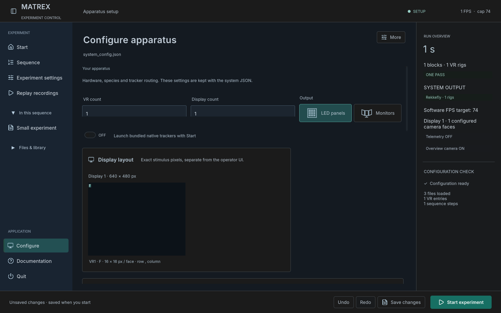

# Greenfield replay and setup validation — 29 October 2026

This supersedes the replay architecture limits in the [earlier overhaul report](overhaul-validation-20261029.md). The release requirement is [same-build replay](same-build-replay-contract.md); historical recordings do not constrain the new contract. [Machine-readable results](same-build-validation-20261029.json).

## Verified behavior

| Check | Result |
| --- | --- |
| Actual record → replay | **1,025 assertions**, two original scene controllers, pre/stimulus/post phases, adaptive changes, six rendered views and forward/reverse scene/stimulus seeks. Worst mean RGB error **0.0199%**; all three adaptive comparisons were exact. Every acquisition file hash remained unchanged. Input was an explicitly synthetic native-format JSON publisher at120Hz. |
| Same-build/state contract | **43 Unity assertions**: whole future config fields, authored row identity, RNG checkpoints, build rejection, journal integrity, bounded seek cache, membership, material blocks, layers, actual drum textures, animation transition bones, resolved Kannadi swarm model, translated/rotated/scaled parent frames, and GPU camera/shadow clocks. |
| Original animations | **359 Unity assertions**: original locust deformation, forward/reverse/pause, procedural wing/flicker timing, imported animated GLB, CSV cache and immutable source hashes. |
| Sixteen-rig acquisition | **96 distinct PlayMode assertions**: all16 rigs through pre/stimulus/post, reset-off continuity of pose/instances, reset-on restoration, saved pose streams and no tracker workers or Unity errors. Earlier 1/2/4/8/16 world/visibility checks remain recorded in the preceding report. |
| GUI | **28 Unity assertions**: default60, exact cap navigation, real delayed typing, Save/Ctrl+S persistence, clean Save disabled, metadata changes, output icons, numeric VR count, overlay placement enable controls, and live cap changes without stopping acquisition or rewriting initial system config. Screenshot reviewed for layout. |
| Exact-byte journals | **89 .NET /88 Unity Mono reader assertions**, including the actual failing Mono numeric spellings, exact-byte integrity, corruption rejection, reverse/delta lookup, bounded caches, cancellation and source immutability. The one runtime count difference reflects file-sharing enforcement. |

Other focused production-code checks passed:682 archive/writer assertions and150 asynchronous lifecycle cycles;66 summary checks;6,843 overlay-layout assertions;1,393 timing assertions;55 apparatus checks;442 world starters;106 active templates/examples;622 preserved hashes;979 preserved inputs. These are separate from physical display timing and native pointer acceptance.

## Implementation and operation

Replay applies complete archived inputs through the original controllers. Rig, population and world evidence share a rendered-frame identity; playback time uses a monotonic clock while retaining wall-clock timestamps. Adaptive callbacks queue event metadata for the final pose row of the frame. New objects are frozen before applying recorded state, and their original parent coordinates are retained. Original animation and serial-state participants restore realized outcomes rather than trying to regenerate measured input from a seed.

New-contract replay verifies the creating build, finalized/drained writer evidence, CSV inventory and hashes, original model/animation availability and exact world frames. The journal verifies emitted bytes before parsing numbers, avoiding Mono number reformatting drift. Missing evidence stops playback. The world reader uses a16-row/32MiB serialized-payload cache; parsed-object overhead is additional. It does not write into the recording.

The visible local build is `Preview/MATREX VR.app`. Double-click `Open MATREX VR Preview.command` at repository root, or `Preview/Open MATREX VR.command`. The launchers use `Preview/Config` and `Preview/RunData`; rebuilding preserves both. Standalone verification is recorded below after packaging.

## Deliberate follow-ups

The [full ordered plan](overhaul-0.5-plan.md) retains rendered object/sky picker previews, arbitrary visibility matrices, panorama azimuth, broad visual redesign, large-video benchmarks and acknowledged recorder control with physical HejjéTrac/Rekkefly hardware. Runtime models use self-contained GLB; Unity vendor packages/FBX need conversion. Native wind/particles need a seek-state participant, and unowned effects are rejected; non-windy trees and baked model animations remain available.

The software checks do not establish sustained16-rig frame pacing, physical calibration/LED timing, native mouse stress acceptance on every count, or Windows/Linux walkthroughs. Preserve the creating player build with each study; another build is allowed to reject the recording.

## Reproduce

Prepare a disposable project with `tools/build_local_desktop.py --prepare-only`. Run `SetupUsabilityValidation.Run`, `SameBuildReplayValidation.Run`, `ReplayAnimationValidation.Run` and `KannadiPhaseValidation.Run` through Unity batchmode. The suites exit themselves. The real acquisition/render comparison uses `tools/run_replay_roundtrip.py` with an explicitly identified publisher. Use only marked diagnostic projects and isolated output directories; the fixtures overwrite their own configurations.
