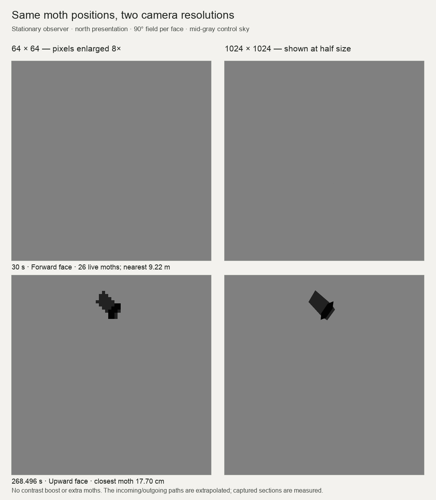
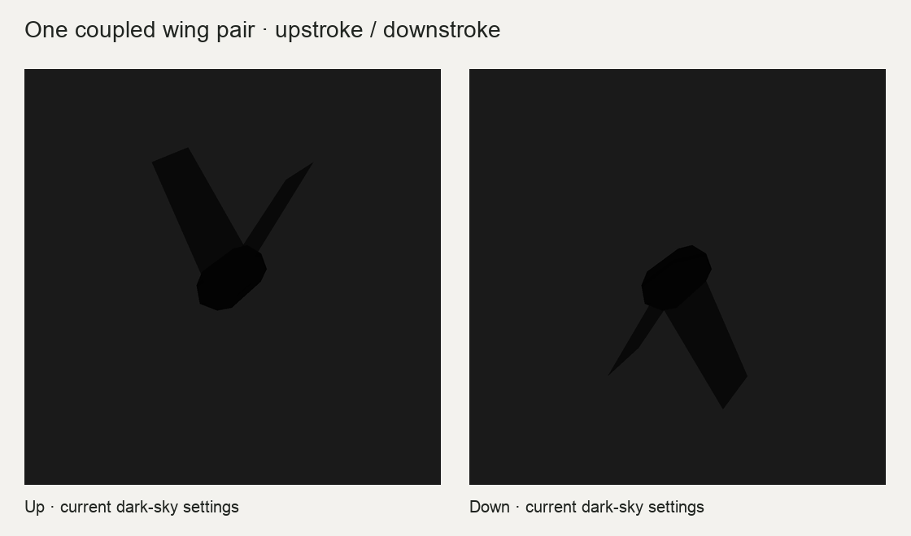

# Bogong moths and recorded swarm playback

Open `Assets/Scenes/ControlScene.unity` and press Play. The active `Assets/StreamingAssets/sequenceConfig.json` auto-starts **Swarm** immediately for 1200 seconds, with a uniform 0.1-gray sky, the recorded swarm's aggregate direction set to **north (0°)**, and each animal starting at yaw 0°, height 5 m. This standalone experiment explicitly uses metres, an **observer flying north at 5 m/s** (`autopilotEnabled: true`, `autopilotSpeed: 5`) and gain 1. Moths spawn at their first recorded sample with zero incoming lead-in, follow their unchanged recorded samples, then continue at 6 m/s until 100 m away. Auto-trim is off for this direct playback recipe. The 599.46-second recording repeats its schedule while previously spawned moths keep flying. Set `autoStart: false` to restore the manual Start button.

The individual experiment is `Examples/Swarm/selwyn-trajectory-playback.example.json`; edit its `playback` and `bogongVisual` settings. `uniformSkyColor` uses normalized RGB, 0–1: 0.5 is gray and 1 is white. A value of 15 is invalid and causes the phase to be rejected; use 15/255 (approximately 0.058824) only if you intend the 8-bit code value 15. These values do not specify physical luminance. The active sky is 0.1. The unlit `bogongVisual.color` is a direct rendered RGB value, not a reflectance multiplied by lighting: the old 0.12 moth nearly matched or exceeded that sky. The active moth uses 0.012 to give a dark silhouette. These explicit values are a stimulus choice, not a calibrated photometric model. The terrain alternative `Examples/Sequences/selwyn-trajectory-playback.example.json` uses Choice_Selwyn and an embedded `swarm` object, with southeast presentation. `Templates/swarm-playback.template.json` has a blank data path and produces a generated swarm until one is supplied. Hardware settings remain in your existing `system_config.json`; these edits preserve camera order and tracker endpoints.

The active observer settings match `Examples/Swarm/selwyn-trajectory-flight-observer.example.json`: autopilot at 5 m/s and `preRollSeconds: 0`; visual/sky settings can differ. The optional `Examples/Swarm/selwyn-trajectory-passive-observer.example.json` uses a stationary observer and five-second incoming lead-in. To select the stationary diagnostic, change the sequence row's `parameters.configFile` to that passive example. Flight templates keep autopilot enabled by default. Ctrl+Space toggles autopilot during a run.

## Coordinates and units

The source uses millimetres: +X north, +Y west, **+Z down**, with Z=0 at 5 m AGL (confirmed October 12, 2026). Converted positions are **metres**, in Unity axes (+X east, +Y up, +Z north):

```
X = -source Y / 1000
Y = 5 - source Z / 1000
Z = source X / 1000
time = TimeExact - earliest TimeExact (seconds)
```

Naive timestamps are Australia/Sydney local time (UTC+11 on October 7, 2026). The shared relative clock preserves gaps between sightings. The converted file retains all 14,429 rows and 430 IDs, local 19:44:35.283–19:54:34.743. The raw source is untouched. Finite outliers are reported in bounds and retained. Positive source Z lowers Unity height. Earlier conversions incorrectly used +Z up; the corrected file reflects height about 5 m, without changing horizontal positions, distances, speeds, IDs or timing.

With the stated axes, aggregate heading is **225.64° (southwest)**. The canonical file preserves those axes. The active standalone Swarm recipe uses `playback.yawOffsetDegrees: -225.64127709737375` to present its aggregate displacement at **0° (north)**. The terrain/flight examples use `-90` for **135.64° (southeast)**. Generated motion uses `mu`; recorded motion uses this explicit yaw offset, preserving each measured trajectory and its spread. Set 0 to retain the measured cardinal direction. Flight direction cannot independently establish geographical calibration. Positive yaw is clockwise from above: N=0°, E=90°, S=180°, W=270°.

Terrain/migration uses metres (`worldUnitsPerMetre: 1`); older walking scenes use centimetres (100). Omitted scale defaults to 1 in a scene with active Terrain, otherwise 100. Prefer explicit values. `playback.dataUnitsPerMetre` describes CSV units, default 1. Positions are multiplied by `worldUnitsPerMetre / dataUnitsPerMetre`. Boundary sizes, offsets, generated swarm speed and autopilot speed remain in existing scene units. For terrain, speed 5 means 5 m/s. Moth dimensions and near clip are physical metres, so the body stays one inch long in either scale. The camera's original near plane is restored when the swarm is cleared.

Centering removes the absolute dataset position/height during presentation. For original georeferenced positions, disable both `centerOnAnimal` and `periodicBoundary`.

## Standalone converter

Python 3.9+ with timezone data is sufficient; no third-party dependencies or Unity are needed:

```sh
python3 tools/convert_swarm_trajectories.py /path/to/long-format.csv Assets/StreamingAssets/SwarmData/new-unity.csv
```

Input columns are Frame, ID, X, Y, Z, TimeExact. Output is exactly `ID,X,Y,Z,time`, sorted by time/ID. IDs stay text. Frame is validated and its range retained in metadata. The sidecar records local start, timezone, units, source hash, bounds, rejected rows and transform choices. Empty IDs, invalid frames/timestamps and nonfinite positions are rejected and reported. Duplicate ID/time pairs raise an error; `--duplicates first|last` explicitly changes that policy. Finite position outliers are retained.

Options: `--source-units mm|cm|m` (mm), `--source-z down|up` (down; use up only for an explicitly upward source dataset), `--output-units m|cm` (m), `--height-origin-m 5`, `--timezone Australia/Sydney`, `--yaw-degrees 0`. Keep converter yaw 0 when using playback yaw to avoid rotating twice.

## Playback settings

| Field | Default | Meaning |
|---|---|---|
| `trajectoryFile` | empty | StreamingAssets-relative or absolute CSV path. Blank preserves generated motion. Supplied missing/malformed files raise errors. |
| `worldUnitsPerMetre` | scene-dependent | Physical scene scale: 1 terrain or 100 walking. |
| `nearClipMetres` | 0.001 for Moth | 1 mm near plane; permits seeing a moth 1 cm ahead. Applied to stimulus cameras, preserving system camera allow-lists. |
| `playback.dataUnitsPerMetre` | 1 | CSV distance scale. |
| `playback.loop` | true | Repeat until the outer experiment/phase ends. |
| `playback.speed` | 1 | Positive time multiplier. |
| `playback.startTimeSeconds` | 0 | Shared clock offset. |
| `playback.maxGapSeconds` | 0.1 | Interpolate across gaps no longer than this; longer missing intervals are invisible. |
| `playback.yawOffsetDegrees` | 0 | Clockwise presentation yaw independent of steering. |
| `playback.centerOnAnimal` | true | Align the full dataset's sample centroid with the animal at each track appearance. |
| `playback.periodicBoundary` | true | Recycle positions through the moving 3D boundary with overshoot preserved. |
| `playback.continueAfterTrack` | false; true in Selwyn examples | Continue each uninterrupted recorded segment at its terminal velocity. Requires `periodicBoundary: false`. |
| `playback.despawnDistanceMetres` | 100 | In continuation mode, retire a moth when its 3D distance from the current animal exceeds this many physical metres. Scaled correctly in centimetre scenes. |
| `playback.terminalVelocityWindowSeconds` | 0.1 | Estimate outgoing velocity from approximately the final 0.1 s of each uninterrupted segment, and incoming velocity from its first 0.1 s. Short segments use available samples; zero uses the endpoint pair. Does not smooth or alter recorded positions. |
| `playback.continuationSpeedMetresPerSecond` | null | Physical speed override for extrapolated incoming/outgoing lines; positive m/s, independent of CSV/scene units. Null retains each measured endpoint velocity. Active recorded examples use 6. Recorded positions/times are unchanged. A singleton or zero-velocity endpoint stays stationary. |
| `playback.preRollSeconds` | 0 | Seconds of straight-line incoming extrapolation before a segment's first sample. Requires `continueAfterTrack: true`. The passive Selwyn example uses 5 (about 30 m at 6 m/s); active/flying examples use 0. Preserve 0 for historical first-sample spawns. No prior recording cycle is invented at startup. |
| `spawnCenter` | zero in examples | World-unit presentation offset. |
| `spawnVolumeSize` | dataset bounds in playback | Explicit positive X/Y/Z periodic volume if supplied; does not rescale or retime tracks. |

With `continueAfterTrack: false`, IDs are pooled at startup and visible only during their recorded lifetimes, retaining the earlier playback behavior. Position is interpolated, heading follows trajectory velocity/elevation, and constant-speed movers are disabled. Data is parsed once and shared across rigs. Tracks receive world anchors at appearance, loop, or gap reappearance. Existing agents do not translate with the animal or rotate with steering; only an enabled periodic boundary recycles crossings. Each rig retains its stimulus layer.

### Spawn-centred continuation (active Selwyn recipe)

The animal is at the **full recording's sample centroid** of the new spawn volume, not necessarily at the centroid of the moths currently visible. The measured centroid is (-0.2697495303, 4.2748470732, 0.1078053752) metres before presentation yaw. At each birth:

```
anchor = animalPositionAtSpawn + spawnCenter - yaw * (recordingCentroid * unitsScale)
worldPosition(t) = anchor + yaw * (recordedPosition(t) * unitsScale)
after the final sample: recordedPosition(t) = lastPosition + finalVelocity * (t - lastTime)
before the first sample: recordedPosition(t) = firstPosition + initialVelocity * (t - firstTime)
```

This is a translation of the recorded volume, with an explicit presentation yaw (north in the active recipe, southeast in the terrain examples); it does not rescale, randomize or retime measured observations. The anchor is frozen at spawn. Turning or moving the animal later changes its view of that moth but cannot drag or steer the moth. New births centre a new copy of the same sampled volume on the animal's current position. The old births then fly outside the small mocap volume without any teleportation or periodic wrapping. Following the same direction and speed can keep a moth alongside the animal beyond the original track's endpoint. It is retired only when it exceeds the 100m distance cutoff or the experiment stops. Matched velocities can retain moths across multiple recording loops; the pool grows only when all existing slots are busy, preserves wing phases and continues to use one batch renderer per rig.

First-sample times, entry positions, recorded trajectories and inter-arrival intervals are measured; **incoming and outgoing lines are extrapolated**, so continuation does not establish unmeasured motion or density beyond the capture volume. Lead-ins instantiate earlier than first samples. A CSV interval without observations can therefore still contain incoming moths and existing tails. The median recorded track length is 0.15 seconds (range 0.02–1.83 seconds). Seven gaps exceed 0.1 seconds; they split into separate recorded segments, each with its own birth and continuation, rather than drawing a false connecting trajectory. A segment with only one sample has no measured velocity and remains stationary until the animal leaves the cutoff. Backward seeking clears tails and initializes recorded/incoming segments present at the seek time, since the animal's past movement is unavailable. Forward frame steps emit every crossed instantiation event, anchoring them at the current frame's animal position.

The active recipe sets `continuationSpeedMetresPerSecond: 6`. This retains each measured endpoint direction and normalizes speed on the incoming/outgoing extrapolation only. The short recorded portion still uses its measured velocity (median 4.10 m/s); the original measured terminal-speed median is 5.02 m/s. Set this override to null to reproduce the earlier measured-speed continuation. `locustSpeed` controls generated motion only, and `playback.speed` changes the entire data clock including arrival rate; neither controls only extrapolated physical speed.

The recording's row-weighted centroid centres its sampled cloud. It is not a survey of the geometric mocap boundary or an instantaneous population centre. With zero `spawnCenter`, `SwarmTrajectoryPlayback.SpawnVolumeCentroid` tracks the animal; the world centroid of existing moths is free to move away. With `centerOnAnimal: false`, canonical absolute data is retained, without the spawn-centred translation.

## Moth visual

Set `agentVisual: "Bogong"`, `bogongVisual.shape: "Moth"`. Dot is still the old default. `Assets/Resources/Bogong/Moth.prefab` is the reusable metre-scale asset. Unity's **GameObject → Experiments → Bogong moth (metres)** creates another editable `BogongMoth` root. Geometry regenerates on enable; edit physical dimensions on the component. Swarms use a shared renderer directly, avoiding one renderer per prefab instance.

| `bogongVisual` field | Default | Meaning |
|---|---|---|
| `shape` | Dot | Moth selects a 3D cigar body and two GPU wing patches. |
| `bodyLengthMetres` | 0.0254 | Length along local +Z. |
| `bodyDiameterMetres` | 0.01 | Body thickness. |
| `wingSpanMetres` | 0.04 | Total two-wing width. |
| `flapFrequencyHz` | 30 | Flap cycles/s; zero gives a static pose. |
| `wingOpacity` | 0.25 | Faint wing blur opacity, 0–1. |
| `subpixelVisibility` | true | Soft proxy below a few pixels, with opacity proportional to projected body area plus faint wings; retains subpixel flap motion. |
| `sizeMode` | World | Physical distance scaling, or Angular for constant apparent nominal body length. |
| `angularSizeDegrees` | 1 | Dot diameter, or nominal moth body length, in Angular mode; orientation still changes the projected shape. |
| `size` | 0.5 world units | Legacy dot diameter; Moth uses physical dimensions. |
| `color` | RGBA .12,.12,.12,1 | Dark gray unlit albedo with cheap body shading. Body alpha stays opaque; use wing opacity for blur. |
| `metallic`, `smoothness` | 0, .25 | Legacy compatibility; unlit visual ignores PBR lighting. |
| `flickerFrequencyHz` | 0 | Whole-agent flicker separate from flap. Zero disables. |
| `flickerDutyCycle` | .5 | Visible fraction, 0–1. |

Each moth has exactly one coupled left/right wing pair: two quads sharing a single 30 Hz flap phase. There is no additional forewing/hindwing pair. The subpixel proxy replaces the body and wings when selected; it is not drawn as an extra wing pair. Near animals use actual low-poly bodies and rudimentary wings. Far animals use an area-weighted bilinear point footprint, fading toward the background rather than failing subpixel triangle rasterization. It distributes the true projected area over one to four pixels, preserving total subpixel contrast as the point crosses pixel boundaries. The previous Gaussian spread this contrast across roughly eight pixels, making individual pixels unnecessarily faint. There is no artificial minimum opacity or increase in physical size. Extreme distances still reach finite 8-bit display precision. No Animator runs per insect. For 30 Hz flapping, 120 FPS is preferable; 60 FPS shows two phases, and 30 FPS can alias. Panel refresh limits available temporal detail.

Flight AGL is settled before the first CSV birth is anchored, preventing first-frame moths from being left behind at the terrain scene’s authored height.

The moth shader uses separate RGB/alpha blending so composited camera textures remain opaque over an opaque background. This preserves the intended faint RGB contrast when exported or displayed in a UI instead of applying transparency a second time. The RGB stimulus rendering is unchanged by the alpha fix.

Existing pooled asynchronous gzip logging is retained. Swarm-scene logs identify agents by `_ID_<source ID>` names and record presented world positions; repeated births add `_C<recording-cycle>_S<segment>` so simultaneous instances are distinguishable. Pool reuse refreshes logger identity caches. Terrain Choice retains its rig logging. Loading a CSV adds no duplicate raw-data writes. Converted data and metadata retain provenance.

## Arrival rate and visibility audit

The supplied recording has 430 IDs over 599.46 seconds: **43.04 unique arrivals/minute**, or 1.39 seconds per arrival on average. Arrival times are bursty: 26–71 IDs per minute, with a longest gap of 12.67 seconds. The 430 allocated root objects are a pool, not 430 simultaneous visible animals. Seven missing-data gaps produce 437 uninterrupted segments, as already documented above.

When multiple IDs have the same recorded timestamp, their median nearest-neighbour distance is **2.16 m**; only four IDs are simultaneously recorded at most. This conditional sample is not a complete census of the surrounding population and does not establish sub-1m spacing. Playback retains the original metre coordinates and spacings. It does not compress the volume or add extra births to create a denser synthetic stimulus.

[Density audit](swarm-density-audit.json) separates measured speeds/spacing from the explicit 6m/s continuation. For a northward observer at 5m/s, an exact-time geometric calculation predicts about 6.2 passes/minute within 1m, 24.4 within 2m and 40.9 within 3m. An arrival is not necessarily a close pass.

The earlier **5 m/s flying-observer** [0.5-gray scene audit](swarm-flight-observer-validation-results.json) sees every source ID, 49 births in the first minute, and about 31 live moths on average with 100m retirement. With the corrected point footprint, 42 first-minute births within 3m produce at least three bytes of gray contrast in native 128px panels; 35 do at 64px. Wing phases can change these sampled counts between runs. These are numerical detection counts in 5×5 patches, sampled at 0.1s, not a biological visibility threshold. Overlapping moths can contribute to the same patch. Gray sky, body dimensions, source positions and birth times are retained. The low-poly body's diameter now reaches the specified 1cm instead of 0.87cm.

Reproduce the data audit without Unity:

```sh
python3 tools/audit_swarm_playback.py Assets/StreamingAssets/SwarmData/selwyn-oct7-unity.csv --config Assets/StreamingAssets/Examples/Swarm/selwyn-trajectory-playback.example.json --observer-speed 5 --report /tmp/swarm-audit.json
```

With zero pre-roll, `SwarmTrajectoryPlayback.TotalBirths` reports first-sample spawns since the last stream reset/seek; `ActiveCount` reports live moths. `SwarmStartupValidation.Run` tests ControlScene and runs the complete ten-minute scene audit in a disposable project.

### Stationary observer and incoming extension

[Passive-observer audit](swarm-passive-observer-audit.json) measures each path's closest 3D approach to the centered, stationary animal. Before incoming extension, seven paths pass within 25 cm over ten minutes (0.70/min), 20 within 50 cm (2.00/min), and 78 within 1 m (7.81/min). The nearest is **17.70 cm**; none reaches 10 cm. Frequent source arrivals therefore do not imply frequent large images. A 2.54 cm body at the nearest distance spans about 4.6 pixels broadside near the center of a 64px, 90° face, or 9.2 at 128px. Orientation and position within the cube face change the projection; most arrivals remain much smaller.

Five seconds of incoming extrapolation raises the predicted counts to 28 within 50 cm and 94 within 1 m, while the seven within 25 cm remain unchanged. These extra path sections are **predictions**, not additional CSV observations. They extend the same paths and do not compress space, enlarge moths, or add source IDs. Adding still more distant trajectory history mostly adds distant, faint moths.

The first sub-25cm pass is ID 158 at **268.496 s (4:28.5)**, also the closest overall. The remaining ones occur around 285.83, 323.45, 429.00, 523.71, 527.87 and 550.87 seconds. There are none in the first four minutes. With the corrected +Z-down conversion, ID 158's closest image is on the upward face; a system omitting that camera cannot display that closest moment. Camera allow-lists remain authoritative. Looping a stationary replay repeats these same encounters rather than generating new random close passes.

For a quick stationary close-pass check, first select `Examples/Swarm/selwyn-trajectory-passive-observer.example.json` in the sequence row, then set `playback.startTimeSeconds: 268.35`; ID 158 passes close about 0.15 seconds after Play. Temporarily set `playback.speed: 0.25` for a labelled diagnostic at quarter speed (about 0.59 seconds until the pass), then restore speed 1 and start time 0 for the normal experiment. This slows the trajectory clock and arrival rate; it does not enlarge the moth or change the shader's real-time 30 Hz wing frequency. The upward camera must be present in system config to show the closest moment.

Instantiate at `firstTime - preRollSeconds`, or at startup for lead-ins already in progress. The complete recorded volume is centered on the animal **at that earlier instantiation**, and its anchor remains fixed through approach, recording and departure. It is not recentered at the first measured sample. Later movement of the observer changes its relative encounters. In particular, a five-second lead-in combined with 5 m/s northward autopilot moves the sampled volume behind the animal; the active and separate flight examples consequently keep pre-roll at zero. Incoming paths initially beyond 100 m remain pending without rendering until they enter the cutoff. Backward seeking clears existing tails and starts current recorded/incoming segments with fresh anchors, since the observer's previous path is unavailable.

Source first-sample times are unchanged, but instantiations happen earlier. The stationary Unity audit emits all 437 uninterrupted segments and sees all 430 IDs. In the first minute it instantiates 54 moths, including five whose first samples occur in the following five seconds; the CSV itself still has 49 first-minute ID starts. At native panel sizes, 43 instances produce at least three bytes of contrast at 64px and 48 at 128px within 3 m. Mean live population is about 15.8, with a maximum of 37. Those contrast counts are numerical detectability, not a human or moth threshold at a given light level. Rendering alone cannot establish night-level visibility without panel luminance and visual-threshold measurements.

`TotalBirths` counts instantiations, including lead-ins; it resets on seek. `ActiveCount` excludes pending incoming instances outside the cutoff. The default zero lead-in retains previous counter timing. Reproduce the passive audit using the command above with `--observer-speed 0` and `--config Assets/StreamingAssets/Examples/Swarm/selwyn-trajectory-passive-observer.example.json`.

## Verification

### Resolution and corrected vertical calibration

[Resolution audit](swarm-resolution-validation-results.json) compares unchanged world positions and wing phases at 64×64 and 1024×1024, including a stationary observer with five-second incoming extension and the active 5 m/s observer with zero extension. Six 90° faces cover the full sphere, including behind/above/below. The high-resolution camera is a rendering diagnostic, not a calibrated human acuity model. Images are saved locally under `Builds/BogongSwarm-resolution`; they use the visual parameters and sky color captured in the report.

At the center of a 90° face, one 64px pixel spans about 1.79°. A 3cm broadside body at 1m spans about 0.96 pixels; at 3m it spans 0.32. A 6cm wingspan at 3m spans 0.64 pixels before foreshortening. One 1024px pixel spans about 0.112°, so the same body at 3m spans about 5.12 pixels. Pixel angles vary across the face. These geometric values do not establish perceptual thresholds or screen luminance.

Distant moths remain in the world and can appear on the back face, but their projected contrast falls with area, approximately as inverse distance squared. Many retained tails are far beyond the few metres where they are detectable in an 8-bit 64px panel. Keeping a moth alive to 100m does not guarantee a visible pixel to 100m. The supplied tracks are arrivals through a small recorded volume, not a simultaneous census of a dense 100m volume.

Correcting source +Z from up to down reflects vertical placement. After centering, all 3D distances and closest-pass times remain the same, but above/below faces and vertical motion reverse. Historical captures and validation reports before October 12 use the old vertical sign; the resolution audit and current source verification use the corrected file. No extra source IDs, spatial compression or artificial opacity floor are introduced.

The current 0.1-sky/0.012-moth recipe retains the locally edited 3cm body, 1cm thickness, 6cm span and 0.75 wing opacity. The four-horizontal-face startup audit detects at least three levels of contrast for 26 of 49 first-minute births at 64px and 41 at 128px; one-level counts are 41 and 42. Phase and overlap affect these numerical counts. All 430 IDs and 437 uninterrupted segments become active. Mean population is 30.68 for the flying observer, but only 0.82 moths on average are within 3m; for the stationary diagnostic the corresponding means are 15.77 and 0.64. Retained tails include moths behind the observer.

The current local hardware file specifies 128×128. The 64px comparisons render that resolution explicitly. If the physical panels are 64×64, use `ledPanelWidth: 64` and `ledPanelHeight: 64` in each corresponding system rig to avoid an additional resolution conversion. Hardware settings are not changed by these diagnostics.



The comparison uses a mid-gray control for legibility, without boosting image contrast. The first row is a stationary snapshot at 30 seconds: 26 live moths, nearest 9.22m. The lower row is the recorded ID 158 close pass at 268.496 seconds, 17.70cm away, on the corrected upward face. The 1024px output is shown at half size; native renders remain in the local capture directory.



`SwarmResolutionValidation.Run` reproduces the full-sphere retention checks and captures in a disposable Unity copy marked `KANNADI_VALIDATION_COPY`. The player never creates these diagnostic cameras or performs readbacks.

### Playback rendering cost

Moth rendering compacts live agents into the start of a shared mesh. It uploads only their centers, rotations and phases; static body/wing/proxy geometry stays in a separate GPU buffer. The draw range contains only live agents. Empty populations disable the renderer and skip uploads. Wing phase follows the pooled agent rather than its temporary draw slot. There is one renderer/material per rig, GPU flapping, no per-moth Animator, and no managed allocation in steady-state pose updates. The playback birth scheduler also uses a sorted event cursor instead of scanning all 437 segments every frame. Asynchronous recording remains in place.

[Performance comparison](swarm-playback-performance-results.json), Unity 6000.3.16f1 on Apple M2 Pro: four pools of 430 slots, 35 live per rig, 24 cameras at 64px. Median CPU pose refresh falls from **1.410 ms to 0.088 ms** (about 16×); refresh plus camera/render submission falls from **4.286 ms to 3.392 ms**. The refresh allocation measurement is zero bytes/frame before and after. At 70 live per rig, refresh is 0.149 ms; at all 430 live, 0.650 ms. These are CPU submission measurements, excluding end-to-end GPU execution, physical displays, tracker processing and the full experiment frame. They establish the eliminated pool overhead, not a guaranteed workstation FPS. The eight raster comparisons retain exact pixels against the previous full-slot mesh at near and subpixel distances, including hosts under translated, rotated and scaled rigs. Partial buffer updates use [Unity's mesh upload API](https://docs.unity3d.com/6000.3/Documentation/ScriptReference/Mesh.SetVertexBufferData.html).

[Incoming/playback validation](swarm-incoming-validation-results.json) records the earlier stationary five-second recipe, playback, rendering, configuration and source checks. [Flying-observer validation](swarm-flight-observer-validation-results.json) records the earlier 0.5-gray flying recipe. [Current corrected-data/contrast validation](swarm-resolution-validation-results.json) records 242 Unity checks, six Python tests, 58 configs and the rebuilt macOS app.

[Earlier visibility/speed validation](swarm-visibility-validation-results.json) records the preceding rendering, arrival and config checks. [Earlier continuation validation](swarm-continuation-validation-results.json) records 61 playback/render/pooling checks, 30 real four-rig terrain checks, 4,833 config/UI checks, 46 ControlScene → Swarm startup checks and 7,866 legacy dot checks passing. [Source verification](swarm-source-verification.json) independently compares every ID, position and relative TimeExact value against the supplied raw CSV: all 14,429 rows match. Reproduce that audit with `python3 tools/verify_swarm_source.py /path/to/Selwyn_Oct_7_2026_LongFormat.csv Assets/StreamingAssets/SwarmData/selwyn-oct7-unity.csv`.

The local 18-second preview at `Builds/BogongSwarm-preview/swarm-playback-and-close-pass.mp4` is captured from Unity Play Mode at deterministic 120fps. It shows the asset at real time and 0.25x, six recorded-swarm camera faces, then ID 158's measured 17.7cm close pass and its extrapolated tail. Slow motion and the direction-following diagnostic camera are labelled. An 8×8 centre crop enlarges pixels without changing contrast; MP4 decoding was checked to retain the faint 248/255 and 254/255 pixels. Capture background/observer settings are diagnostic only; the video uses the earlier southeast presentation. The active main experiment now uses a gray standalone Swarm sky, north presentation, observer autopilot at 5 m/s and zero incoming lead-in.

Converter tests: `python3 -m unittest discover -s tools -p test_convert_swarm_trajectories.py`. `SwarmTrajectoryValidation.Run` on a disposable Unity copy checks 64×64 renders, 1 cm visibility, subpixel fading, flap poses, interpolation, lifetimes, world anchors, loops and metre/centimetre scale. Existing `BogongDotValidation.Run` and `SelwynSwarmValidation.Run` retain reference raster/timing checks. Timing results describe the test machine, not guaranteed LED workstation FPS.

[Saved results](swarm-playback-validation-results.json): 39 render/playback/prefab checks, 30 real Selwyn sequence checks, 4,743 strict catalog/UI checks, and 798,525 generated-swarm/reference checks passed in Unity 6000.3.16f1. The four-rig test verifies metre dimensions, 5 m/s autopilot, 5 m AGL, per-rig visibility, disabled camera letters and near-plane restoration. The isolated 1,024-agent test across 24 cameras at 64×64 measured median CPU times of 2.27 ms for dots and 2.89 ms for moths on an M2 Pro; these measurements exclude real display hardware and the full experiment frame.
